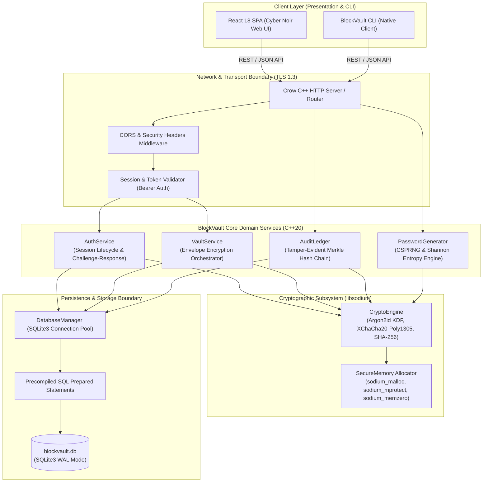
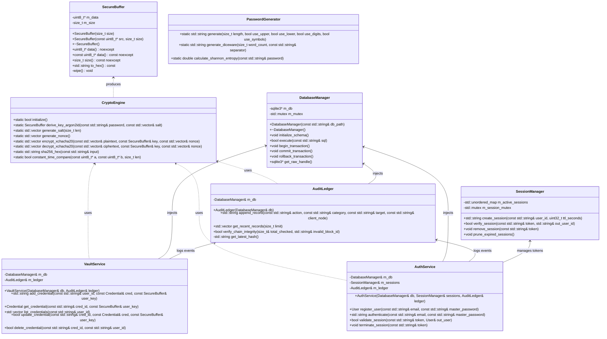
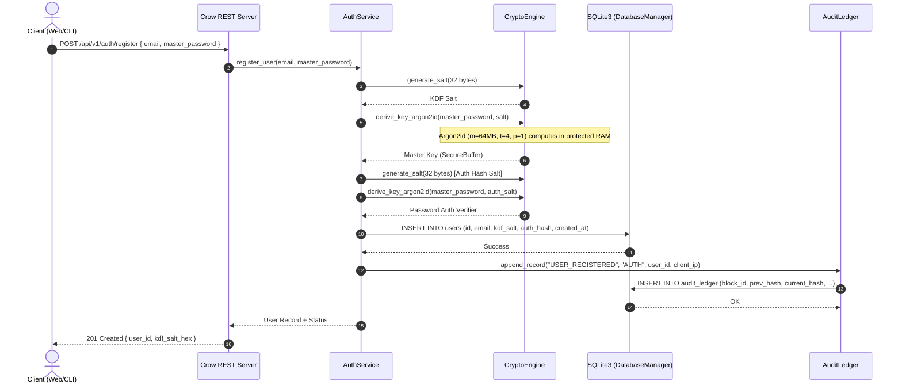
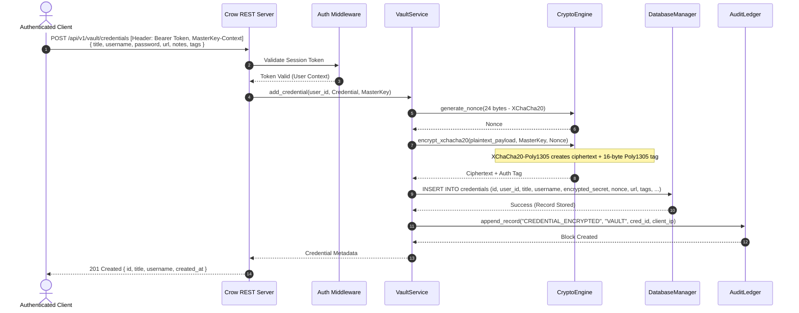
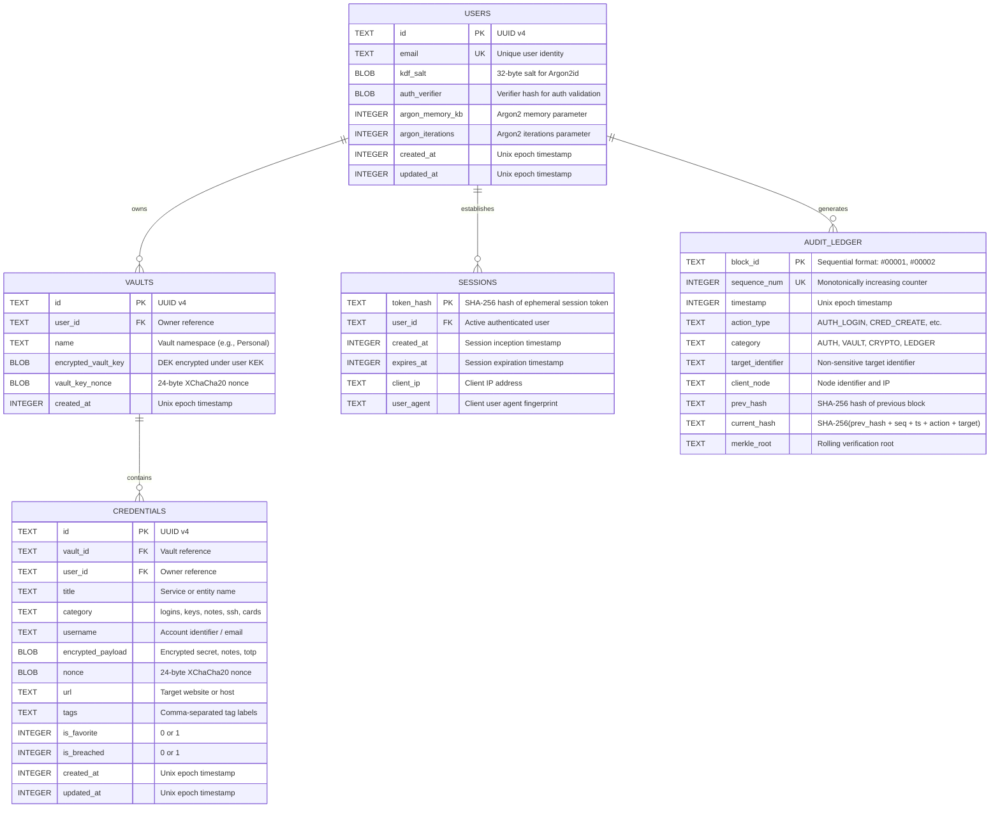

# BlockVault — System Architecture Specification & Engineering Guide
**Version:** 1.0.0-PROD  
**Language Standard:** ISO/IEC 14882:2020 (C++20)  
**Target Platform:** Linux (POSIX), Windows 10/11 (MSVC 2022 / MinGW-w64), macOS (Clang 15+)  
**Primary Cryptographic Provider:** libsodium (1.0.18+)  
**Application Server:** Crow C++ Web Framework  
**Data Engine:** SQLite3 (WAL mode, prepared statements)

---

## 1. System Overview & Architectural Philosophy

BlockVault is engineered as a **Zero-Knowledge, Client-Isolated Cryptographic Vault & Telemetry Server**. The core architectural premise is that **the server and database never possess plaintext credentials, raw master passwords, or unencrypted data keys**.

### Key Architectural Principles
1. **Zero-Knowledge Envelope Security:** The master password never crosses network boundaries in plaintext. Key derivation (Argon2id) creates a Key Encryption Key (KEK), which encrypts ephemeral Vault Data Keys (DEK).
2. **Defensive In-Memory Sanitization:** Sensitive cryptographic keys and decrypted payloads must reside in locked, non-swappable volatile memory (`sodium_mlock`) and must be strictly zeroed out upon destruction via `sodium_memzero`.
3. **Immutable Local Audit Ledger:** Every state change (create, read, update, delete, rotate, auth) appends an event to a local hash-linked journal. Every record includes the cryptographic digest of the prior entry (`PrevHash`), forming an unbroken SHA-256 verification chain.
4. **Strict Separation of Concerns:** Database access, cryptographic primitives, business workflow, and HTTP routing are decoupled behind clean abstract interfaces and C++20 concepts.

---

## 2. System Architecture Diagram



---

## 3. Complete Project Folder Structure

The project follows the standard modern CMake multi-target directory structure:

```
BlockVault/
├── CMakeLists.txt                  # Root build configuration
├── cmake/                          # Custom CMake helper modules & toolchains
│   ├── FindSodium.cmake            # Libsodium discovery module
│   └── CompilerWarnings.cmake      # Strict compiler warning flags (-Wall, -Wextra, etc.)
│
├── include/                        # Public C++ interface headers
│   └── blockvault/
│       ├── api/                    # Crow HTTP endpoint handlers & routes
│       │   ├── AuthController.hpp
│       │   ├── VaultController.hpp
│       │   ├── GeneratorController.hpp
│       │   ├── AuditController.hpp
│       │   └── Middleware.hpp
│       │
│       ├── auth/                   # Authentication & session token management
│       │   ├── SessionManager.hpp
│       │   └── Token.hpp
│       │
│       ├── crypto/                 # Libsodium cryptographic interfaces
│       │   ├── CryptoEngine.hpp    # Argon2id, XChaCha20-Poly1305, SHA-256
│       │   ├── SecureBuffer.hpp    # RAII wrapper for zeroed sensitive memory
│       │   └── Entropy.hpp         # Shannon entropy calculation
│       │
│       ├── db/                     # SQLite3 persistence abstraction
│       │   ├── DatabaseManager.hpp # RAII connection and transaction manager
│       │   ├── QueryBuilder.hpp    # Safe parameter binding helpers
│       │   └── Migrations.hpp      # Auto DDL schema initialization
│       │
│       ├── ledger/                 # Local cryptographic audit ledger
│       │   ├── AuditLedger.hpp     # Append-only hash chain
│       │   └── AuditBlock.hpp      # Merkle ledger block structure
│       │
│       ├── models/                 # Pure data transfer structures
│       │   ├── User.hpp
│       │   ├── Vault.hpp
│       │   ├── Credential.hpp
│       │   └── AuditRecord.hpp
│       │
│       ├── vault/                  # Domain business logic
│       │   ├── VaultService.hpp
│       │   └── PasswordGenerator.hpp
│       │
│       └── utils/                  # Cross-cutting logging and formatting
│           ├── Base64.hpp
│           ├── Hex.hpp
│           └── Logger.hpp
│
├── src/                            # Implementation files (.cpp)
│   ├── main.cpp                    # Application bootstrap & entry point
│   ├── api/
│   │   ├── AuthController.cpp
│   │   ├── VaultController.cpp
│   │   ├── GeneratorController.cpp
│   │   └── AuditController.cpp
│   ├── auth/
│   │   └── SessionManager.cpp
│   ├── crypto/
│   │   ├── CryptoEngine.cpp
│   │   └── SecureBuffer.cpp
│   ├── db/
│   │   ├── DatabaseManager.cpp
│   │   └── Migrations.cpp
│   ├── ledger/
│   │   └── AuditLedger.cpp
│   ├── vault/
│   │   ├── VaultService.cpp
│   │   └── PasswordGenerator.cpp
│   └── utils/
│       ├── Base64.cpp
│       ├── Hex.cpp
│       └── Logger.cpp
│
├── tests/                          # Automated testing suite
│   ├── CMakeLists.txt
│   ├── unit/
│   │   ├── test_crypto.cpp         # Argon2id and encryption unit tests
│   │   ├── test_generator.cpp      # Entropy and random generation tests
│   │   ├── test_database.cpp       # Prepared statements and migrations
│   │   └── test_ledger.cpp         # Hash chain tamper resistance tests
│   └── integration/
│       ├── test_api_auth.cpp       # Endpoint session testing
│       └── test_api_vault.cpp      # End-to-end credential CRUD testing
│
├── docs/                           # Architecture, threat model, API specifications
│   ├── ARCHITECTURE.md
│   ├── API_SPEC.md
│   ├── THREAT_MODEL.md
│   └── ROADMAP.md
│
└── frontend/                       # React 18 / Vite Cyber Noir SPA
    ├── package.json
    ├── vite.config.js
    ├── index.html
    └── src/
```

---

## 4. Module Responsibilities & Architectural Boundaries

| Module | Core Responsibility | Input | Output | Dependencies |
|---|---|---|---|---|
| **CryptoEngine** | Argon2id key derivation, authenticated envelope encryption (XChaCha20-Poly1305), SHA-256 hashing, CSPRNG | Plaintext bytes, Master key, Nonce | Ciphertext bytes, Auth tags, Digest | `libsodium`, `SecureBuffer` |
| **SecureBuffer** | RAII memory manager for sensitive keys, allocates non-pageable memory, zeroing upon destruction | Byte size or raw memory | Safe RAII wrapped buffer | `sodium_malloc`, `sodium_memzero` |
| **DatabaseManager**| SQLite3 connection lifecycle, ACID transaction manager, precompiled prepared statements | SQL strings, typed parameters | Typed records, result rows | `sqlite3` C API |
| **AuthService** | User registration, password verification via constant-time KDF checks, session token generation | Username, Master pass, Salt | Authenticated session token | `CryptoEngine`, `DatabaseManager` |
| **VaultService** | Credential CRUD, metadata management, envelope decryption orchestrator | Encrypted credential payloads | Serialized JSON credential models | `CryptoEngine`, `DatabaseManager`, `AuditLedger` |
| **AuditLedger** | Tamper-evident sequential hash chaining of system events; chain validation | Action name, Target, Timestamp | Chained block with SHA-256 hash | `CryptoEngine`, `DatabaseManager` |
| **PasswordGenerator**| Entropy synthesizer, character set pools, Shannon entropy calculation | Length, character flags, mode | Cryptographic random strings, Entropy score | `CryptoEngine` |
| **CrowServer & API**| HTTP routing, JSON serialization, CORS, header parsing, HTTP response formatting | Inbound HTTP Requests | Outbound HTTP Responses (JSON) | `crow_all.h`, `nlohmann/json`, Domain Services |

---

## 5. UML Class Diagram



---

## 6. End-to-End Application Workflows

### 6.1 Registration & Vault Initialization



### 6.2 Credential Storage (Envelope Encryption)



---

## 7. Database Entities & Relationships

The database is built on top of SQLite3 with WAL (Write-Ahead Logging) enabled for maximum concurrency and ACID safety. All queries utilize compiled prepared statements.



### Database Schema DDL (SQLite3)

```sql
PRAGMA journal_mode = WAL;
PRAGMA foreign_keys = ON;
PRAGMA synchronous = NORMAL;

-- Users Table
CREATE TABLE IF NOT EXISTS users (
    id TEXT PRIMARY KEY,
    email TEXT UNIQUE NOT NULL,
    kdf_salt BLOB NOT NULL,
    auth_verifier BLOB NOT NULL,
    argon_memory_kb INTEGER NOT NULL DEFAULT 65536,
    argon_iterations INTEGER NOT NULL DEFAULT 4,
    created_at INTEGER NOT NULL,
    updated_at INTEGER NOT NULL
);

-- Vaults Table
CREATE TABLE IF NOT EXISTS vaults (
    id TEXT PRIMARY KEY,
    user_id TEXT NOT NULL,
    name TEXT NOT NULL,
    encrypted_vault_key BLOB NOT NULL,
    vault_key_nonce BLOB NOT NULL,
    created_at INTEGER NOT NULL,
    FOREIGN KEY(user_id) REFERENCES users(id) ON DELETE CASCADE
);

-- Credentials Table
CREATE TABLE IF NOT EXISTS credentials (
    id TEXT PRIMARY KEY,
    vault_id TEXT NOT NULL,
    user_id TEXT NOT NULL,
    title TEXT NOT NULL,
    category TEXT NOT NULL DEFAULT 'logins',
    username TEXT,
    encrypted_payload BLOB NOT NULL,
    nonce BLOB NOT NULL,
    url TEXT,
    tags TEXT,
    is_favorite INTEGER NOT NULL DEFAULT 0,
    is_breached INTEGER NOT NULL DEFAULT 0,
    created_at INTEGER NOT NULL,
    updated_at INTEGER NOT NULL,
    FOREIGN KEY(vault_id) REFERENCES vaults(id) ON DELETE CASCADE,
    FOREIGN KEY(user_id) REFERENCES users(id) ON DELETE CASCADE
);

CREATE INDEX IF NOT EXISTS idx_credentials_user ON credentials(user_id);
CREATE INDEX IF NOT EXISTS idx_credentials_vault ON credentials(vault_id);

-- Active Sessions Table
CREATE TABLE IF NOT EXISTS sessions (
    token_hash TEXT PRIMARY KEY,
    user_id TEXT NOT NULL,
    created_at INTEGER NOT NULL,
    expires_at INTEGER NOT NULL,
    client_ip TEXT NOT NULL,
    user_agent TEXT NOT NULL,
    FOREIGN KEY(user_id) REFERENCES users(id) ON DELETE CASCADE
);

-- Local Hash-Linked Audit Ledger Table
CREATE TABLE IF NOT EXISTS audit_ledger (
    block_id TEXT PRIMARY KEY,
    sequence_num INTEGER UNIQUE NOT NULL,
    timestamp INTEGER NOT NULL,
    action_type TEXT NOT NULL,
    category TEXT NOT NULL,
    target_identifier TEXT NOT NULL,
    client_node TEXT NOT NULL,
    prev_hash TEXT NOT NULL,
    current_hash TEXT NOT NULL,
    merkle_root TEXT NOT NULL
);

CREATE INDEX IF NOT EXISTS idx_audit_seq ON audit_ledger(sequence_num);
```

---

## 8. Cryptographic Data Flow & Key Hierarchy

The cryptographic engine follows a strict key separation model:

```
[ Master Password (User Memory) ]
              │
              ▼  (libsodium: crypto_pwhash_argon2id)
     [ KEK: Key Encryption Key (256-bit) ]  <--- Exists solely in locked RAM (SecureBuffer)
              │
              ├──► Used to decrypt Vault Key (DEK)
              │
              ▼  (libsodium: crypto_aead_xchacha20poly1305_ietf_encrypt)
     [ DEK: Data Encryption Key (256-bit) ] <--- Encrypts individual credential secrets
              │
              ├──► Encrypts Credentials Payload + Nonce (24-byte)
              │
              ▼
   [ Encrypted SQLite Ciphertext Storage ]
```

### Cryptographic Invariants:
1. **Never Reused Nonces:** Nonces for XChaCha20-Poly1305 are 192 bits (24 bytes) generated via `randombytes_buf`. At 192 bits, random nonces guarantee zero collision probability across the lifetime of the vault.
2. **Ephemeral Lifespan:** Plaintext keys are unpinned and wiped (`sodium_memzero`) as soon as the active cryptographic operation completes.
3. **Ledger Zero-Knowledge:** Audit records log the fact that an encryption or decryption operation occurred on a target ID; **neither the ciphertext, nonce, nor key is ever written to the audit chain**.

---

## 9. Technical Mentoring Deep Dives (5-Point Framework)

As requested, each core technical architectural decision is analyzed across all 5 dimensions.

### 9.1 Decision 1: C++20 Standard & Modern Idioms

#### 1. What it is:
The 2020 revision of the ISO C++ standard, featuring Concepts (`template <typename T> requires ...`), Ranges (`std::ranges`), `std::span` (non-owning bounds-checked memory views), Coroutines, and `<format>`.

#### 2. Why it is required:
Writing secure cryptographic software requires strict type safety, zero unexpected pointer decay, and deterministic lifecycle control. C++20 eliminates legacy C-style pointer hazards through `std::span<const uint8_t>` for buffer inspections without allocations.

#### 3. How it works:
- Instead of passing `const char* ptr, int len` (error-prone), functions accept `std::span<const uint8_t>` which encapsulates pointer + length into a single type-safe slice.
- Concepts enforce compile-time constraints on template arguments, ensuring only compatible byte buffers are passed to cryptographic functions.

#### 4. Alternatives:
- **C++11/C++14/C++17:** Older standards lack `std::span` and Concepts, forcing developers to rely on raw pointers or heavy third-party types (`gsl::span`).
- **Rust:** Excellent memory safety, but this project explicitly targets mastery of modern C++ systems engineering.
- **Go/Python:** Garbage-collected languages make deterministic memory zeroing (`sodium_memzero`) impossible because the garbage collector can move secrets across heap memory without wiping them.

#### 5. Advantages & Disadvantages:
- **Advantages:** Zero runtime overhead, compile-time safety, clean modern syntax, standard spans for cryptographic memory views.
- **Disadvantages:** Requires modern compilers (GCC 12+, Clang 15+, MSVC 2022); compile times are longer with extensive template metaprogramming.

---

### 9.2 Decision 2: Crow C++ Web Framework

#### 1. What it is:
A fast, lightweight, header-only C++ web microframework inspired by Python Flask, built on top of standalone Asio.

#### 2. Why it is required:
To expose secure REST endpoints that the React frontend can consume while keeping the backend entirely native, high-performance, and lightweight.

#### 3. How it works:
Crow binds lambda expressions to URL routes using macros (`CROW_ROUTE(app, "/api/v1/vault")`), parses HTTP headers, handles JSON serialization via `nlohmann/json` or Crow's built-in JSON, and serves requests using an asynchronous event loop.

#### 4. Alternatives:
- **Drogon:** High performance, but very heavy, uses reflection, and introduces significant build complexity.
- **cpp-httplib:** Very simple header-only library, but single-threaded or thread-per-connection without native asynchronous pipeline abstractions.
- **Pistache:** Good POSIX support, but poor/non-existent native Windows MSVC support.

#### 5. Advantages & Disadvantages:
- **Advantages:** Easy route syntax, integrated async I/O via Asio, cross-platform support (Windows/Linux/macOS), minimal dependency footprint.
- **Disadvantages:** Less active development than commercial enterprise servers; requires careful exception handling inside route handlers to avoid process termination.

---

### 9.3 Decision 3: libsodium Cryptography Library

#### 1. What it is:
A modern, easy-to-use software library for encryption, decryption, signatures, password hashing, and secure memory allocation. It is a portable fork of NaCl.

#### 2. Why it is required:
Cryptographic vulnerabilities rarely stem from mathematical flaws in algorithms; they stem from **implementation misuse** (e.g., non-constant-time comparisons, reused nonces, unauthenticated encryption, weak PRNGs). libsodium is explicitly designed to be **misuse-resistant**.

#### 3. How it works:
Instead of requiring developers to manually configure block cipher modes, padding schemes, and HMAC tags, libsodium provides high-level authenticated encryption primitives:
- `crypto_pwhash()` for Argon2id.
- `crypto_aead_xchacha20poly1305_ietf_encrypt()` for authenticated encryption with extended 192-bit nonces.
- `sodium_memzero()` for compiler-guaranteed secret clearing.

#### 4. Alternatives:
- **OpenSSL:** Industry standard, but has a notoriously complex, low-level C API with dozens of initialization flags where a single missed configuration breaches security.
- **Crypto++ / Botan:** Excellent C++ libraries, but have heavier code footprints and larger surface areas.

#### 5. Advantages & Disadvantages:
- **Advantages:** Audited, constant-time operations immune to cache-timing attacks, built-in non-swappable secure memory allocation (`sodium_malloc`), universal industry trust.
- **Disadvantages:** C API requires small C++ RAII wrapper classes to ensure automatic cleanup; must be installed or fetched via CMake.

---

### 9.4 Decision 4: Argon2id for Password-Based Key Derivation

#### 1. What it is:
The winner of the Password Hashing Competition (PHC). Argon2id is a hybrid of Argon2d (data-dependent memory access) and Argon2i (data-independent memory access), providing state-of-the-art resistance against both side-channel and GPU/ASIC attacks.

#### 2. Why it is required:
A password manager's master key is the single barrier protecting all other credentials. Simple hashes like SHA-256 or MD5 can be brute-forced at rates of billions of guesses per second on modern GPUs. Argon2id forces the cracker to dedicate both high CPU time **and vast amounts of RAM** (e.g., 64 MB per attempt), rendering GPU farm cracking economically unfeasible.

#### 3. How it works:
`crypto_pwhash(derived_key, key_len, password, pass_len, salt, opslimit, memlimit, crypto_pwhash_ALG_ARGON2ID13)`:
It allocates an array of `memlimit` bytes in RAM and repeatedly writes and XORs pseudorandom blocks in a memory-hard pattern for `opslimit` iterations before generating the derived key.

#### 4. Alternatives:
- **PBKDF2:** NIST legacy approved, but has **zero memory hardness**; easily brute-forced with cheap ASICs and GPUs.
- **bcrypt:** Good against CPU cracking, but limited to 72-byte passwords and maximum 4 KB of memory usage.
- **scrypt:** Memory-hard, but vulnerable to side-channel cache timing attacks compared to Argon2id.

#### 5. Advantages & Disadvantages:
- **Advantages:** Mathematically superior against modern hardware attacks, tunable memory and time cost parameters, default standard in modern zero-knowledge tools.
- **Disadvantages:** Slower derivation on low-end hardware; memory consumption must be calibrated so multi-user servers are not subjected to Denial of Service via concurrent KDF calls.

---

### 9.5 Decision 5: SQLite3 with Precompiled Prepared Statements

#### 1. What it is:
A self-contained, serverless, zero-configuration, transactional SQL database engine running directly in the host C++ process memory.

#### 2. Why it is required:
BlockVault is intended to run as a personal or enterprise self-hosted vault system without requiring a complex external database server like PostgreSQL or MySQL.

#### 3. How it works:
- SQLite runs inside the C++ application binary.
- All SQL commands use `sqlite3_prepare_v2` and parameter binding (`sqlite3_bind_text`, `sqlite3_bind_blob`). This completely separates SQL syntax from user data, making **SQL injection mathematically impossible**.
- SQLite WAL (Write-Ahead Log) mode enables concurrent readers while writing operations execute safely.

#### 4. Alternatives:
- **PostgreSQL / MySQL:** Powerful, but introduces network latency, external process management, and heavy installation prerequisites.
- **Flat JSON / Binary Files:** No ACID transactions; prone to file corruption if the process crashes mid-write.
- **DuckDB / RocksDB:** Good performance, but SQLite has decades of unmatched stability, zero-knowledge encryption extensions, and universal SQL tooling.

#### 5. Advantages & Disadvantages:
- **Advantages:** Zero setup, compact single-file database (`blockvault.db`), ACID compliant, blazing fast in-process execution.
- **Disadvantages:** Single-writer limitation (handled transparently by WAL mode and mutex synchronization); requires manual connection management.

---

### 9.6 Decision 6: Local Hash-Linked Audit Ledger

#### 1. What it is:
A sequential, tamper-evident cryptographic journal where every record contains the SHA-256 cryptographic hash of its predecessor:
$$\text{CurrentHash} = \text{SHA256}(\text{PrevHash} \parallel \text{Sequence} \parallel \text{Timestamp} \parallel \text{Action} \parallel \text{Target})$$

#### 2. Why it is required:
In cybersecurity compliance (SOC 2, ISO 27001), vault auditing must be tamper-evident. If an attacker gains unauthorized access to the database and attempts to delete or modify a past audit record, the cryptographic hash link breaks, immediately exposing the tampering during integrity verification.

#### 3. How it works:
- On genesis, Block #00001 uses a known seed hash (`0x0000000000000000`).
- Each subsequent event calculates its hash based on the previous block's hash.
- The `verify_chain_integrity()` function iterates through the entire table in $O(N)$ time, recomputing hashes. Any altered timestamp, target, or missing row causes a mismatch.

#### 4. Alternatives:
- **Decentralized Blockchain (Ethereum/Solana):** Unsuitable. Public blockchains broadcast transaction metadata globally, introduce gas fees, require miners/validators, and have catastrophic latency for private password management.
- **Plain Text / Log Files (e.g., syslog):** Trivially edited or truncated by any local administrator without detection.

#### 5. Advantages & Disadvantages:
- **Advantages:** Tamper-evident mathematical verification, zero cloud leakage, instant local verification, zero cost, completely transparent.
- **Disadvantages:** Does not provide distributed consensus (a complete database overwrite by a root attacker requires out-of-band signed backup comparisons).

---

## 10. Summary & Sign-off Gate

This architecture provides a complete, military-grade foundation for BlockVault. Before writing implementation code, review the accompanying companion specifications:
1. `API_SPEC.md` — HTTP endpoints and JSON contracts.
2. `THREAT_MODEL.md` — STRIDE analysis and defensive boundaries.
3. `ROADMAP.md` — Phased implementation plan and milestones.

*Awaiting your review and explicit approval before commencing Phase 1 C++ implementation.*

