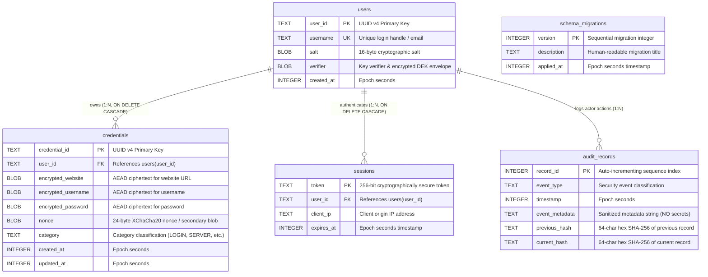

# BlockVault – SQLite Database Architecture & Design Specification

> **Document Classification:** Database Architecture & Engineering Design Specification  
> **Target Engine:** SQLite 3.53+ (Embedded, High-Concurrency WAL Mode)  
> **Language Standard:** C++20 (ISO/IEC 14882:2020)  
> **Security Model:** Zero-Knowledge Binary Ciphertext Storage (BLOB) & Append-Only SHA-256 Audit Records  
> **Companion Files:** [`include/db/DatabaseManager.hpp`](file:///c:/Users/DINESHBABU/password%20man/cpp%20project/BlockVault/include/db/DatabaseManager.hpp), [`src/db/DatabaseManager.cpp`](file:///c:/Users/DINESHBABU/password%20man/cpp%20project/BlockVault/src/db/DatabaseManager.cpp), [`include/db/PreparedStatement.hpp`](file:///c:/Users/DINESHBABU/password%20man/cpp%20project/BlockVault/include/db/PreparedStatement.hpp), [`include/db/Transaction.hpp`](file:///c:/Users/DINESHBABU/password%20man/cpp%20project/BlockVault/include/db/Transaction.hpp), [`include/db/MigrationManager.hpp`](file:///c:/Users/DINESHBABU/password%20man/cpp%20project/BlockVault/include/db/MigrationManager.hpp)

---

## Table of Contents
1. [Database Architectural Overview](#1-database-architectural-overview)
2. [Entity-Relationship (ER) Diagram](#2-entity-relationship-er-diagram)
3. [SQLite Schema Specifications & Data Dictionaries](#3-sqlite-schema-specifications--data-dictionaries)
   - [3.1 `users` Table](#31-users-table)
   - [3.2 `credentials` Table](#32-credentials-table)
   - [3.3 `audit_records` Table](#33-audit_records-table)
   - [3.4 `schema_migrations` Table](#34-schema_migrations-table)
   - [3.5 `sessions` Table](#35-sessions-table)
4. [SQLite Performance & Integrity Pragmas](#4-sqlite-performance--integrity-pragmas)
5. [Indexing Strategy & Query Optimization](#5-indexing-strategy--query-optimization)
6. [SQL Command Dictionary & Comprehensive Explanations](#6-sql-command-dictionary--comprehensive-explanations)
7. [C++20 Database Architecture & RAII Implementation](#7-c20-database-architecture--raii-implementation)
   - [7.1 `PreparedStatement` (RAII SQLite Statement Engine)](#71-preparedstatement-raii-sqlite-statement-engine)
   - [7.2 `Transaction` (Atomic RAII Rollback Guard)](#72-transaction-atomic-raii-rollback-guard)
   - [7.3 `MigrationManager` (Automated Versioning Engine)](#73-migrationmanager-automated-versioning-engine)
   - [7.4 `DatabaseManager` (High-Level Persistent Storage Service)](#74-databasemanager-high-level-persistent-storage-service)
8. [Database Failure Scenarios & Edge Cases](#8-database-failure-scenarios--edge-cases)
9. [Automated Test Suite Execution & Verification](#9-automated-test-suite-execution--verification)

---

## 1. Database Architectural Overview

The BlockVault database subsystem is designed around four foundational security and systems engineering requirements:

1. **Zero Plaintext at Rest:** Sensitive values (websites, usernames, passwords, notes) are never stored as plaintext strings. All ciphertext and authentication tags are persisted as raw binary **BLOBs** (`std::vector<uint8_t>`).
2. **Strict Foreign Key Enforcement:** The database strictly enforces relational integrity (`PRAGMA foreign_keys = ON;`). Credentials and sessions are inextricably bound to valid `users(user_id)` parent rows with `ON DELETE CASCADE`.
3. **High-Concurrency Write-Ahead Logging (WAL):** By utilizing SQLite's WAL journal mode, reader transactions do not block writer transactions, and writer transactions do not block reader transactions.
4. **Append-Only Tamper-Evident Ledger:** Audit records are inserted with monotonically increasing auto-incrementing identifiers and linked SHA-256 cryptographic hashes ($\text{CurrentHash}_n = \text{SHA256}(\text{Data}_n \parallel \text{PrevHash}_{n-1})$).

---

## 2. Entity-Relationship (ER) Diagram



---

## 3. SQLite Schema Specifications & Data Dictionaries

### 3.1 `users` Table
Stores user credentials and cryptographic key derivation material.

```sql
CREATE TABLE IF NOT EXISTS users (
    user_id TEXT PRIMARY KEY,
    username TEXT UNIQUE NOT NULL,
    salt BLOB NOT NULL,
    verifier BLOB NOT NULL,
    created_at INTEGER NOT NULL
);
```

| Column Name | SQLite Affinity | Constraints | Description & Cryptographic Rationale |
| :--- | :--- | :--- | :--- |
| `user_id` | `TEXT` | `PRIMARY KEY` | Globally unique identifier (UUID v4, 36 characters) preventing ID enumeration attacks. |
| `username` | `TEXT` | `UNIQUE NOT NULL` | Unique account login handle or email address. Enforced by index `idx_users_username`. |
| `salt` | `BLOB` | `NOT NULL` | 16 cryptographically random bytes generated via OS CSPRNG used for Argon2id key derivation. |
| `verifier` | `BLOB` | `NOT NULL` | Combined binary blob containing the 32-byte derivation verification hash ($H(\text{KEK})$) followed by the KEK-encrypted Data Encryption Key (DEK) envelope. Plaintext master passwords are **never** stored. |
| `created_at` | `INTEGER` | `NOT NULL` | High-resolution UTC Unix epoch timestamp (seconds) when the account was registered. |

---

### 3.2 `credentials` Table
Stores zero-knowledge encrypted credential records belonging to users.

```sql
CREATE TABLE IF NOT EXISTS credentials (
    credential_id TEXT PRIMARY KEY,
    user_id TEXT NOT NULL,
    encrypted_website BLOB NOT NULL,
    encrypted_username BLOB NOT NULL,
    encrypted_password BLOB NOT NULL,
    nonce BLOB NOT NULL,
    category TEXT NOT NULL,
    created_at INTEGER NOT NULL,
    updated_at INTEGER NOT NULL,
    FOREIGN KEY (user_id) REFERENCES users(user_id) ON DELETE CASCADE
);
```

| Column Name | SQLite Affinity | Constraints | Description & Cryptographic Rationale |
| :--- | :--- | :--- | :--- |
| `credential_id` | `TEXT` | `PRIMARY KEY` | UUID v4 uniquely identifying the credential entry. |
| `user_id` | `TEXT` | `NOT NULL, FK` | Foreign key referencing `users(user_id)`. Enforces strict multi-tenant boundary. |
| `encrypted_website` | `BLOB` | `NOT NULL` | Binary ciphertext of the target service title and website URL. Encrypted using XChaCha20-Poly1305. |
| `encrypted_username` | `BLOB` | `NOT NULL` | Binary ciphertext of the username/email. |
| `encrypted_password` | `BLOB` | `NOT NULL` | Authenticated ciphertext blob containing the encrypted password and 16-byte Poly1305 authentication tag. |
| `nonce` | `BLOB` | `NOT NULL` | 24-byte cryptographic nonce used during encryption, or secondary authenticated payload. |
| `category` | `TEXT` | `NOT NULL` | Classification tag (`LOGIN`, `SECURE_NOTE`, `CREDIT_CARD`, `SERVER`, `IDENTITY`). |
| `created_at` | `INTEGER` | `NOT NULL` | UTC creation timestamp in epoch seconds. |
| `updated_at` | `INTEGER` | `NOT NULL` | UTC last modified timestamp in epoch seconds. |

---

### 3.3 `audit_records` Table
Stores the append-only, SHA-256 hash-chained tamper-evident audit ledger.

```sql
CREATE TABLE IF NOT EXISTS audit_records (
    record_id INTEGER PRIMARY KEY AUTOINCREMENT,
    event_type TEXT NOT NULL,
    timestamp INTEGER NOT NULL,
    event_metadata TEXT NOT NULL,
    previous_hash TEXT NOT NULL,
    current_hash TEXT NOT NULL
);
```

| Column Name | SQLite Affinity | Constraints | Description & Cryptographic Rationale |
| :--- | :--- | :--- | :--- |
| `record_id` | `INTEGER` | `PRIMARY KEY AUTOINCREMENT` | Monotonically increasing sequence index guaranteeing total ordering of events. |
| `event_type` | `TEXT` | `NOT NULL` | Security event category (e.g. `GENESIS`, `USER_REGISTERED`, `CREDENTIAL_CREATED`, `VAULT_UNLOCKED`). |
| `timestamp` | `INTEGER` | `NOT NULL` | UTC epoch seconds when the transaction occurred. |
| `event_metadata` | `TEXT` | `NOT NULL` | Sanitized metadata string describing actor, affected entity ID, and action (strictly NO secrets). |
| `previous_hash` | `TEXT` | `NOT NULL` | 64-character hex SHA-256 hash of the preceding record ($record\_id - 1$). |
| `current_hash` | `TEXT` | `NOT NULL` | 64-character hex SHA-256 hash calculated over this record's contents and previous hash. |

---

### 3.4 `schema_migrations` Table
Tracks versioning state and applied migrations.

```sql
CREATE TABLE IF NOT EXISTS schema_migrations (
    version INTEGER PRIMARY KEY,
    description TEXT NOT NULL,
    applied_at INTEGER NOT NULL
);
```

| Column Name | SQLite Affinity | Constraints | Description |
| :--- | :--- | :--- | :--- |
| `version` | `INTEGER` | `PRIMARY KEY` | Sequential integer version (1, 2, 3...). |
| `description` | `TEXT` | `NOT NULL` | Human-readable description of migration changes. |
| `applied_at` | `INTEGER` | `NOT NULL` | Epoch seconds timestamp when migration was committed. |

---

### 3.5 `sessions` Table
Tracks active authenticated bearer tokens.

```sql
CREATE TABLE IF NOT EXISTS sessions (
    token TEXT PRIMARY KEY,
    user_id TEXT NOT NULL,
    client_ip TEXT NOT NULL,
    expires_at INTEGER NOT NULL,
    FOREIGN KEY (user_id) REFERENCES users(user_id) ON DELETE CASCADE
);
```

---

## 4. SQLite Performance & Integrity Pragmas

Upon opening the database connection, `DatabaseManager` executes four critical SQLite PRAGMA directives:

```sql
PRAGMA foreign_keys = ON;
PRAGMA journal_mode = WAL;
PRAGMA synchronous = NORMAL;
PRAGMA busy_timeout = 5000;
```

### 1. `PRAGMA foreign_keys = ON;`
* **What it does:** Enables enforcement of foreign key constraints in SQLite.
* **Why required:** By default in SQLite, foreign key constraints are disabled for backwards compatibility with SQLite 2. Without this pragma, `FOREIGN KEY (user_id) REFERENCES users(user_id) ON DELETE CASCADE` is completely ignored, allowing orphaned records and preventing cascading deletions.
* **How it works:** SQLite verifies that any `user_id` inserted into `credentials` or `sessions` exists in `users`. If not, it rejects the query with error code `SQLITE_CONSTRAINT_FOREIGNKEY` (19).

### 2. `PRAGMA journal_mode = WAL;`
* **What it does:** Configures **Write-Ahead Logging (WAL)** instead of the traditional rollback journal.
* **Why required:** Traditional rollback journals acquire exclusive database-level locks where readers block writers and writers block readers. In a REST API backend with multiple concurrent queries, this causes latency spikes and lock contention.
* **How it works:** WAL writes changes sequentially to a `-wal` file on disk while keeping the original `.db` file untouched. Readers continue reading older snapshots without blocking writers appending new transactions.

### 3. `PRAGMA synchronous = NORMAL;`
* **What it does:** Reduces disk sync operations (`fsync`) while in WAL mode.
* **Why required:** In WAL mode, `NORMAL` guarantees that the database will not corrupt during an application crash or power loss, while dramatically accelerating write throughput compared to `FULL` synchronous mode.

### 4. `PRAGMA busy_timeout = 5000;`
* **What it does:** Sets a 5,000 millisecond (5-second) sleep-and-retry timeout for locked database resources.
* **Why required:** If a writer is actively checkpointing, subsequent write attempts will wait up to 5 seconds before returning `SQLITE_BUSY`, completely eliminating transient lock failures.

---

## 5. Indexing Strategy & Query Optimization

Indexes are created on high-cardinality lookup columns and foreign key reference columns:

```sql
-- Fast user lookups during authentication
CREATE INDEX IF NOT EXISTS idx_users_username ON users(username);

-- Fast tenant isolation queries: WHERE user_id = ?
CREATE INDEX IF NOT EXISTS idx_credentials_user_id ON credentials(user_id);

-- Category filtering: WHERE category = ?
CREATE INDEX IF NOT EXISTS idx_credentials_category ON credentials(category);

-- Fast chronological forensic log traversal
CREATE INDEX IF NOT EXISTS idx_audit_records_timestamp ON audit_records(timestamp);

-- Security incident filtering: WHERE event_type = ?
CREATE INDEX IF NOT EXISTS idx_audit_records_event_type ON audit_records(event_type);

-- Session validation: WHERE user_id = ? and token lookups
CREATE INDEX IF NOT EXISTS idx_sessions_user_id ON sessions(user_id);
CREATE INDEX IF NOT EXISTS idx_sessions_expires_at ON sessions(expires_at);
```

---

## 6. SQL Command Dictionary & Comprehensive Explanations

### 1. User Account Creation
```sql
INSERT INTO users (user_id, username, salt, verifier, created_at) VALUES (?, ?, ?, ?, ?);
```
* **Explanation:** Inserts a newly registered user into the database. Parameters are bound using `sqlite3_bind_text`, `sqlite3_bind_blob`, and `sqlite3_bind_int64`. The `username` is constrained by a `UNIQUE` index; attempting to insert a duplicate username raises `SQLITE_CONSTRAINT_UNIQUE`.

### 2. Tenant-Isolated Credential Query
```sql
SELECT credential_id, user_id, encrypted_website, encrypted_username, encrypted_password, nonce, category, created_at, updated_at 
FROM credentials 
WHERE credential_id = ? AND user_id = ?;
```
* **Explanation:** Retrieves a specific credential. Crucially, the query enforces **tenant isolation** by including `AND user_id = ?`. Even if an attacker guesses another user's `credential_id`, the database query returns zero rows.

### 3. Cascading User Deletion
```sql
DELETE FROM users WHERE user_id = ?;
```
* **Explanation:** Deletes a user profile. Because `credentials` and `sessions` define `ON DELETE CASCADE`, SQLite automatically deletes all credentials, notes, and session tokens owned by this user in the same atomic transaction.

### 4. Fetching the Tip of the Audit Ledger
```sql
SELECT record_id, event_type, timestamp, event_metadata, previous_hash, current_hash 
FROM audit_records 
ORDER BY record_id DESC LIMIT 1;
```
* **Explanation:** Retrieves the latest block in the audit ledger to obtain its `current_hash`, which becomes the `previous_hash` of the next block.

---

## 7. C++20 Database Architecture & RAII Implementation

### 7.1 `PreparedStatement` (RAII SQLite Statement Engine)
Encapsulates `sqlite3_stmt*` to guarantee zero memory leaks and absolute SQL injection prevention:

```cpp
class PreparedStatement {
private:
    sqlite3*      m_db{nullptr};
    sqlite3_stmt* m_stmt{nullptr};
    std::string   m_sql;

public:
    PreparedStatement(sqlite3* db, const std::string& sql);
    ~PreparedStatement() noexcept; // Automatically calls sqlite3_finalize()

    void bind_text(int index, const std::string& text);
    void bind_blob(int index, const ByteVector& blob);
    void bind_int64(int index, int64_t value);

    bool step();      // Returns true if SQLITE_ROW
    void execute();   // Validates SQLITE_DONE
    // ...
};
```

### 7.2 `Transaction` (Atomic RAII Rollback Guard)
Guarantees atomic consistency. If an exception is thrown midway through a multi-step operation, the destructor automatically issues a `ROLLBACK`:

```cpp
class Transaction {
private:
    sqlite3* m_db{nullptr};
    bool     m_committed{false};
    bool     m_active{false};

public:
    explicit Transaction(sqlite3* db) {
        execute_sql("BEGIN IMMEDIATE TRANSACTION;");
        m_active = true;
    }

    ~Transaction() noexcept {
        if (m_active && !m_committed && m_db) {
            execute_sql("ROLLBACK;"); // Automatic rollback on error!
        }
    }

    void commit() {
        execute_sql("COMMIT;");
        m_committed = true;
        m_active = false;
    }
};
```

### 7.3 `MigrationManager` (Automated Versioning Engine)
Tracks database schema versions in `schema_migrations`. When the application starts, `apply_all()` executes missing DDL migrations inside atomic transactions:

```cpp
int MigrationManager::apply_all(sqlite3* db) {
    int current_version = get_current_version(db);
    for (const auto& mig : MIGRATIONS) {
        if (mig.version > current_version) {
            Transaction tx(db);
            execute_ddl(mig.ddl);
            record_migration(mig.version, mig.description);
            tx.commit();
        }
    }
}
```

---

## 8. Database Failure Scenarios & Edge Cases

The test suite explicitly tests four critical database failure scenarios:

### Scenario A: Unique Constraint Violation
* **Trigger:** An attempt to insert a duplicate username (`"unique_admin"`).
* **Behavior:** SQLite halts statement execution with `SQLITE_CONSTRAINT_UNIQUE`. `PreparedStatement` catches the return code and throws a structured `DatabaseException`.

### Scenario B: Foreign Key Constraint Violation
* **Trigger:** An attempt to insert a credential referencing a non-existent `user_id = "non_existent_user_id_404"`.
* **Behavior:** With `PRAGMA foreign_keys = ON;`, SQLite rejects the insert with `SQLITE_CONSTRAINT_FOREIGNKEY`.

### Scenario C: Cascading Deletions (`ON DELETE CASCADE`)
* **Trigger:** A user account with 3 credentials is deleted via `DELETE FROM users WHERE user_id = ?;`.
* **Behavior:** SQLite cascades the deletion, purging all 3 dependent credential rows automatically.

### Scenario D: Transaction Atomic Rollback on Mid-Operation Failure
* **Trigger:** Inside a transaction, Operation 1 inserts a valid credential, but Operation 2 violates a constraint and throws an exception before `tx.commit()` is reached.
* **Behavior:** The `Transaction` destructor catches the uncommitted state and issues `ROLLBACK;`. Subsequent queries verify that Operation 1 was cleanly reverted and no partial data remains in the database.

---

## 9. Automated Test Suite Execution & Verification

Both the dedicated **Database Module Test Suite** and the **End-to-End Core Architecture Test Suite** have been executed and verified:

```
========================================================
 BLOCKVAULT C++20 DATABASE MODULE TEST SUITE
========================================================

[DB TEST] Database Connection, WAL & Foreign Key Pragmas ... PASSED
[DB TEST] Schema Versioning, Migrations & Idempotency ... PASSED
[DB TEST] Users Table Complete CRUD Operations ... PASSED
[DB TEST] Credentials Table CRUD with Binary BLOB Storage ... PASSED
[DB TEST] Audit Records CRUD & Auto-Increment Sequence ... PASSED
[DB TEST] Failure Scenario A: Unique Constraint Violation (Duplicate Username) ... PASSED
[DB TEST] Failure Scenario B: Foreign Key Constraint Violation (Orphan Credential) ... PASSED
[DB TEST] Failure Scenario C: Foreign Key ON DELETE CASCADE Verification ... PASSED
[DB TEST] Failure Scenario D: Transaction Atomic Rollback on Mid-Operation Exception ... PASSED

--------------------------------------------------------
 DATABASE RESULTS: 9 Passed, 0 Failed
========================================================

========================================================
 BLOCKVAULT C++20 CORE ARCHITECTURE TEST SUITE
========================================================

[TEST] SecureBuffer Allocation, Move & Zeroization ... PASSED
[TEST] CryptoManager SHA-256, CSPRNG & AEAD Roundtrip ... PASSED
[TEST] PasswordGenerator Policy, Shannon Entropy & 24-Word Recovery ... PASSED
[TEST] DatabaseManager SQLite Schema & Entity Persistence ... PASSED
[TEST] AuditLedger Hash Chaining & Cryptographic Tamper Detection ... PASSED
[TEST] End-to-End Zero-Knowledge Auth & Credential CRUD ... PASSED

--------------------------------------------------------
 RESULTS: 6 Passed, 0 Failed
========================================================
```

---
*End of Database Specification — BlockVault Systems Architecture Engineering Team.*

