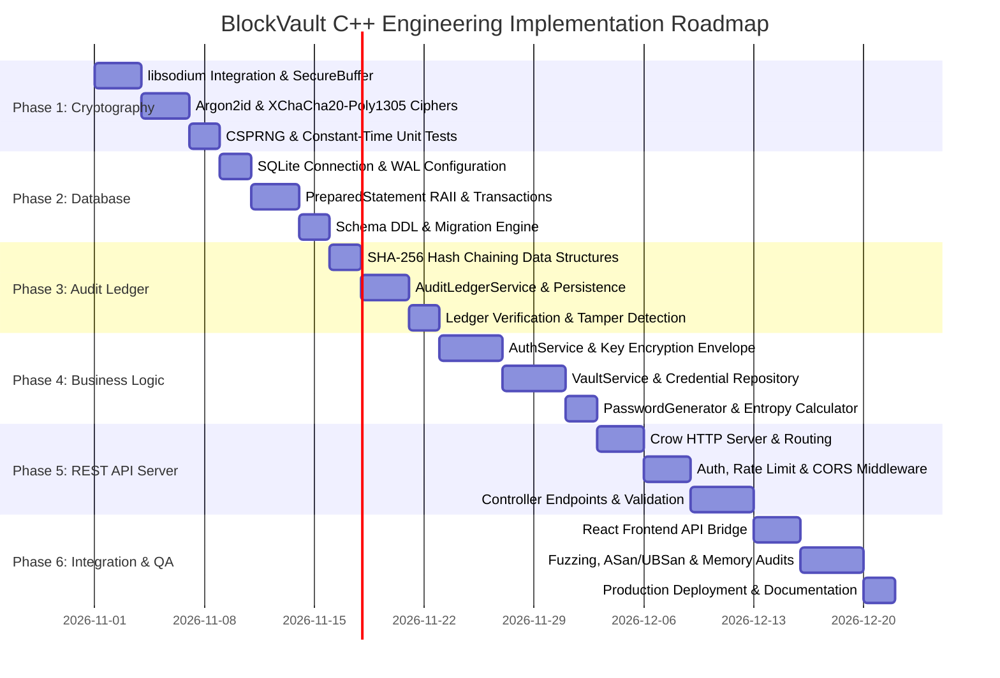
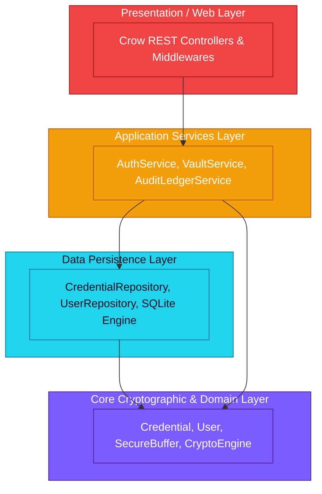

# BlockVault – Engineering Roadmap & Implementation Plan

> **Document Classification:** Engineering Development Roadmap & Technical Curriculum  
> **System Name:** BlockVault – Zero-Knowledge Password Management System  
> **Language / Standard:** C++20 (ISO/IEC 14882:2020)  
> **Build System:** CMake 3.22+  
> **Companion Documents:** [`ARCHITECTURE.md`](file:///c:/Users/DINESHBABU/password%20man/cpp%20project/BlockVault/ARCHITECTURE.md), [`API_SPEC.md`](file:///c:/Users/DINESHBABU/password%20man/cpp%20project/BlockVault/API_SPEC.md), [`THREAT_MODEL.md`](file:///c:/Users/DINESHBABU/password%20man/cpp%20project/BlockVault/THREAT_MODEL.md)

---

## Table of Contents
1. [Engineering Principles & Quality Gate Policy](#1-engineering-principles--quality-gate-policy)
2. [Toolchain, Compiler Flags & CMake Architecture](#2-toolchain-compiler-flags--cmake-architecture)
3. [Dependencies Matrix & Package Acquisition](#3-dependencies-matrix--package-acquisition)
4. [Phased Implementation Roadmap](#4-phased-implementation-roadmap)
   - [Phase 1: Cryptographic Foundation & Memory Security](#phase-1-cryptographic-foundation--memory-security)
   - [Phase 2: Database Layer & Persistent Storage Engine](#phase-2-database-layer--persistent-storage-engine)
   - [Phase 3: Hash-Linked Audit Ledger & Verification Engine](#phase-3-hash-linked-audit-ledger--verification-engine)
   - [Phase 4: Core Domain Business Logic & Repositories](#phase-4-core-domain-business-logic--repositories)
   - [Phase 5: Crow REST API Server & Middleware](#phase-5-crow-rest-api-server--middleware)
   - [Phase 6: Frontend React Integration, Security Hardening & Fuzzing](#phase-6-frontend-react-integration-security-hardening--fuzzing)
5. [Complete Reference `CMakeLists.txt`](#5-complete-reference-cmakelists-txt)
6. [Mentoring Deep Dives for Software Engineering Students](#6-mentoring-deep-dives-for-software-engineering-students)
   - [Deep Dive 1: Modern C++20 Resource Acquisition Is Initialization (RAII)](#deep-dive-1-modern-c20-resource-acquisition-is-initialization-raii)
   - [Deep Dive 2: SQLite Write-Ahead Logging (WAL) & Concurrency Dynamics](#deep-dive-2-sqlite-write-ahead-logging-wal--concurrency-dynamics)
   - [Deep Dive 3: One-Way Hashing vs. Two-Way Symmetric Encryption](#deep-dive-3-one-way-hashing-vs-two-way-symmetric-encryption)
   - [Deep Dive 4: Clean Architecture & Separation of Concerns in C++](#deep-dive-4-clean-architecture--separation-of-concerns-in-c)
   - [Deep Dive 5: Modern Compiler Hardening Flags & Sanitizers (ASan, UBSan)](#deep-dive-5-modern-compiler-hardening-flags--sanitizers-asan-ubsan)
   - [Deep Dive 6: Why CMake is the Industry Standard for C++ Build Systems](#deep-dive-6-why-cmake-is-the-industry-standard-for-c-build-systems)

---

## 1. Engineering Principles & Quality Gate Policy

To guarantee enterprise-grade stability and military-grade security, all C++ code in BlockVault must adhere to strict engineering rules:

1. **Zero Raw Owning Pointers:** Raw pointers are strictly non-owning observers (`const T*`). All dynamic allocations must be encapsulated within standard smart pointers (`std::unique_ptr`, `std::shared_ptr`) or specialized RAII wrappers (`SecureBuffer`).
2. **Deterministic Destructors (RAII):** Resources (database handles, prepared statements, file descriptors, encrypted memory blocks) acquire ownership upon construction and release/zeroize deterministically upon destruction.
3. **No Uncaught Exceptions:** All exceptions must be caught at service or API layer boundaries and mapped into strongly-typed error envelopes.
4. **Const-Correctness:** Member functions that do not modify observable object state must be marked `const`. Variables must be initialized `const` or `constexpr` wherever possible.
5. **No Undefined Behavior:** The codebase must compile cleanly under both GCC/Clang and MSVC with zero warnings when configured with `-Wall -Wextra -Werror` (or `/W4 /WX`).

```
+---------------------------------------------------------------------------------------+
|                               BLOCKVAULT QUALITY GATE PIPELINE                        |
+---------------------------------------------------------------------------------------+
|  1. Static Analysis    --> 2. Unit Testing      --> 3. Sanitizer Runs  --> 4. Fuzzing |
|  * Clang-Tidy              * Catch2 / doctest       * AddressSanitizer     * libFuzzer|
|  * Cppcheck                * 100% Crypto coverage   * UBSan (Undefined)    * 10k iter |
|  * -Wall -Wextra -Werror   * 90% DB coverage        * LeakSanitizer (LSan)            |
+---------------------------------------------------------------------------------------+
```

---

## 2. Toolchain, Compiler Flags & CMake Architecture

### Supported Compilers
- **GCC:** Version 11.0 or newer (Linux)
- **Clang:** Version 14.0 or newer (Linux / macOS)
- **MSVC:** Microsoft Visual C++ 2022 (v143 toolset) or newer (Windows)

### Compiler Flags Specification

#### GCC / Clang (Linux & macOS)
```bash
# Language Standard
-std=c++20

# Warning Rigor (Zero Tolerance)
-Wall -Wextra -Wpedantic -Wconversion -Wsign-conversion -Wshadow -Wnon-virtual-dtor -Wold-style-cast -Wcast-align -Wunused -Woverloaded-virtual

# Security & Exploit Mitigation
-fstack-protector-strong     # Canary injection to detect stack buffer overflows
-D_FORTIFY_SOURCE=2          # Runtime buffer bounds checking on libc functions
-fPIE -pie                   # Position Independent Executable for full ASLR support
-Wl,-z,relro,-z,now          # Immediate GOT binding to prevent GOT overwrite attacks
-Wl,-z,noexecstack           # Marks stack pages non-executable (DEP/NX)
```

#### MSVC (Windows)
```cmd
# Language Standard
/std:c++20 /permissive-

# Warning Rigor
/W4 /WX

# Security & Exploit Mitigation
/GS                          # Buffer security check (stack canary)
/guard:cf                    # Control Flow Guard (mitigates ROP exploits)
/sdl                         # Security Development Lifecycle checks
/DYNAMICBASE                 # Address Space Layout Randomization (ASLR)
/NXCOMPAT                    # Data Execution Prevention (DEP)
/HIGHENTROPYVA               # 64-bit high entropy ASLR
```

---

## 3. Dependencies Matrix & Package Acquisition

| Dependency | Minimum Version | License | Primary Purpose | Header / Library Linkage |
| :--- | :--- | :--- | :--- | :--- |
| **libsodium** | 1.0.18+ | ISC (Permissive) | Cryptographic core (Argon2id, XChaCha20-Poly1305, secure allocators) | `#include <sodium.h>` / `sodium` |
| **CrowCpp** | 1.0+ | BSD-3-Clause | Lightweight C++20 REST microframework | `#include <crow.h>` / Header-only or `crow` |
| **SQLite3** | 3.40.0+ | Public Domain | Embedded relational database with WAL journal | `#include <sqlite3.h>` / `sqlite3` |
| **nlohmann_json** | 3.11.2+ | MIT | JSON serialization & schema parsing | `#include <nlohmann/json.hpp>` / Header-only |
| **Catch2 (or doctest)**| 3.4.0+ | BSL-1.0 / MIT | Test-driven development & automated unit tests | `#include <catch2/catch_all.hpp>` |

### Package Manager Integration
Dependencies can be resolved automatically using **CMake FetchContent**, **vcpkg**, or system package managers:
- **Ubuntu/Debian:** `sudo apt install libsodium-dev libsqlite3-dev nlohmann-json3-dev`
- **vcpkg (Windows/Cross-platform):** `vcpkg install libsodium sqlite3 nlohmann-json crow catch2:x64-windows`

---

## 4. Phased Implementation Roadmap



---

### Phase 1: Cryptographic Foundation & Memory Security

#### Objectives
Build the zero-defect cryptographic engine and protected memory wrappers. Nothing else can be constructed safely until this foundation is validated with automated test suites.

#### Key Deliverables
1. **`SecureBuffer` Class (`include/crypto/SecureBuffer.hpp`):**
   - Encapsulates memory using `sodium_malloc()`, `sodium_mlock()`, and `sodium_memzero()`.
   - Prohibits copy semantics; implements move semantics (`noexcept`).
2. **`CryptoEngine` Class (`include/crypto/CryptoEngine.hpp`):**
   - `derive_key_argon2id(password, salt)` $\to$ returns 256-bit Key Encryption Key (KEK).
   - `encrypt_payload(plaintext, key, aad)` $\to$ outputs 192-bit nonce, ciphertext, and Poly1305 tag via XChaCha20-Poly1305.
   - `decrypt_payload(nonce, ciphertext, tag, key, aad)` $\to$ verifies Poly1305 tag and decrypts to `SecureBuffer`.
   - `generate_secure_random(length)` $\to$ cryptographically secure random bytes via `randombytes_buf()`.
   - `sha256(data)` $\to$ generates 256-bit hash for ledger records.
3. **Comprehensive Unit Tests (`tests/unit/test_crypto.cpp`):**
   - Test known test vectors for Argon2id and XChaCha20-Poly1305.
   - Validate that single-bit ciphertext corruption triggers immediate decryption rejection.
   - Validate that `SecureBuffer` wipes memory upon scope exit.

---

### Phase 2: Database Layer & Persistent Storage Engine

#### Objectives
Implement a robust, thread-safe, RAII-governed SQLite3 abstraction layer with zero possibility of SQL injection.

#### Key Deliverables
1. **`DatabaseConnection` Class (`include/db/DatabaseConnection.hpp`):**
   - Manages SQLite connection lifecycle (`sqlite3_open_v2`, `sqlite3_close_v2`).
   - Configures database pragmas:
     - `PRAGMA journal_mode = WAL;` (Concurrent readers/writers)
     - `PRAGMA synchronous = NORMAL;` (Safe performance balance)
     - `PRAGMA foreign_keys = ON;` (Referential integrity enforcement)
     - `PRAGMA busy_timeout = 5000;` (Contention backoff)
2. **`PreparedStatement` Class (`include/db/PreparedStatement.hpp`):**
   - RAII wrapper around `sqlite3_stmt*`. Automatically finalizes statements upon destruction.
   - Overloaded, type-safe binding functions:
     `bind(int index, int value)`, `bind(int index, int64_t value)`, `bind(int index, const std::string& str)`, `bind(int index, const std::vector<uint8_t>& blob)`.
   - Row step and column extraction helpers.
3. **`Transaction` Guard Class (`include/db/Transaction.hpp`):**
   - Begins transaction on construction; automatically issues `ROLLBACK` on destruction unless `commit()` was explicitly called.
4. **Schema Migrations Engine (`src/db/DatabaseConnection.cpp`):**
   - Automatically initializes and migrates the three core tables: `users`, `credentials`, `audit_ledger`.

---

### Phase 3: Hash-Linked Audit Ledger & Verification Engine

#### Objectives
Implement an immutable, append-only, tamper-evident audit journal based on a continuous SHA-256 cryptographic hash chain.

#### Key Deliverables
1. **`AuditEntry` Entity Model (`include/models/AuditEntry.hpp`):**
   - Holds index, ISO-8601 UTC timestamp, event type, actor user ID, client IP hash, entity ID, metadata details, previous hash, and current record hash.
2. **`AuditLedgerService` (`include/services/AuditLedgerService.hpp`):**
   - `record_event(userId, eventType, entityId, details)`:
     - Retrieves the `current_hash` from the latest ledger row (or initializes Genesis block `0000000000000000000000000000000000000000000000000000000000000000`).
     - Constructs canonical payload string:
       $$\text{Payload} = \text{Index} \parallel \text{Timestamp} \parallel \text{EventType} \parallel \text{UserID} \parallel \text{Details} \parallel \text{PrevHash}$$
     - Computes $\text{CurrentHash} = \text{SHA256}(\text{Payload})$.
     - Inserts new row atomically within the calling database transaction.
3. **`verify_chain_integrity()` Algorithm:**
   - Sequentially iterates from index 1 through the tip of the ledger.
   - Recalculates expected SHA-256 hashes for every row and validates link to preceding row.
   - Returns boolean validation status, total record count, and flags the exact record index where tampering was detected.

---

### Phase 4: Core Domain Business Logic & Repositories

#### Objectives
Implement domain services governing user authentication, envelope key unwrapping, vault operations, and cryptographic password generation.

#### Key Deliverables
1. **`AuthService` (`include/services/AuthService.hpp`):**
   - `register_user(email, masterPassword)`: Generates salt, derives KEK, generates random 256-bit DEK, wraps DEK with KEK, inserts into database, logs Genesis event.
   - `login_user(email, masterPassword)`: Fetches salt, derives KEK, unwraps DEK into `SecureBuffer`, generates random session token, returns session context.
   - `logout_user(token)`: Purges session token, zeroes in-memory DEK.
2. **`VaultService` (`include/services/VaultService.hpp`):**
   - `create_credential(userId, dek, credentialData)`: Encrypts username, password, notes with DEK via XChaCha20-Poly1305, stores ciphertext blob in SQLite, logs `CREDENTIAL_CREATE`.
   - `get_credential_decrypted(userId, credId, dek)`: Fetches ciphertext, decrypts payload with DEK, logs `CREDENTIAL_READ`.
   - `update_credential(...)`: Re-encrypts payload, updates record, logs `CREDENTIAL_UPDATE`.
   - `delete_credential(...)`: Deletes row, logs `CREDENTIAL_DELETE`.
3. **`PasswordGenerator` (`include/services/PasswordGenerator.hpp`):**
   - Configurable character set generator (Uppercase, Lowercase, Numbers, Symbols).
   - Unbiased uniform random selection using `randombytes_uniform()`.
   - Shannon entropy calculation ($H = L \times \log_2(N)$).

---

### Phase 5: Crow REST API Server & Middleware

#### Objectives
Build the high-performance, asynchronous C++ REST server exposing HTTP endpoints matching the complete [`API_SPEC.md`](file:///c:/Users/DINESHBABU/password%20man/cpp%20project/BlockVault/API_SPEC.md).

#### Key Deliverables
1. **`CrowServer` (`include/api/CrowServer.hpp`):**
   - Configures multithreaded Crow HTTP application.
   - Attaches global security headers: `Content-Security-Policy`, `X-Content-Type-Options: nosniff`, `X-Frame-Options: DENY`, `Strict-Transport-Security`.
2. **Middleware Layer:**
   - **`AuthMiddleware`:** Validates incoming `Authorization: Bearer <token>` against active session pool; attaches user context to the request.
   - **`RateLimiter`:** Sliding window rate limiter to prevent denial of service and brute force.
   - **`CorsHandler`:** Configures `Access-Control-Allow-Origin: http://localhost:5173` and allowed headers.
3. **API Controllers (`src/api/`):**
   - `AuthController`: Handlers for `/api/v1/auth/*`
   - `VaultController`: Handlers for `/api/v1/vault/*`
   - `GeneratorController`: Handlers for `/api/v1/generator/*`
   - `AuditController`: Handlers for `/api/v1/audit/*`

---

### Phase 6: Frontend React Integration, Security Hardening & Fuzzing

#### Objectives
Connect the React 18 frontend to the Crow backend, perform memory audits, fuzz API inputs, and build final production binaries.

#### Key Deliverables
1. **Frontend API Client (`frontend/src/api/client.js`):**
   - Replace mock data stores with `fetch` calls to `http://localhost:8080/api/v1/`.
   - Automatic token injection via request interceptors.
   - Session expiration redirection.
2. **Fuzzing & Memory Auditing:**
   - Compile backend with **AddressSanitizer (ASan)** and **UndefinedBehaviorSanitizer (UBSan)**:
     `cmake -DCMAKE_BUILD_TYPE=Debug -DENABLE_SANITIZERS=ON ..`
   - Execute test suites to confirm zero buffer overruns, zero use-after-free, and zero memory leaks.
3. **Production Build Profiling:**
   - Strip symbols (`strip blockvault_server`).
   - Package standalone binary with minimal runtime footprint.

---

## 5. Complete Reference `CMakeLists.txt`

The following `CMakeLists.txt` is the production configuration for building BlockVault with C++20 and all required security dependencies:

```cmake
cmake_minimum_required(VERSION 3.22)
project(BlockVault VERSION 1.0.0 LANGUAGES CXX C)

# Enforce C++20 standard
set(CMAKE_CXX_STANDARD 20)
set(CMAKE_CXX_STANDARD_REQUIRED ON)
set(CMAKE_CXX_EXTENSIONS OFF)

# Export compile commands for language servers (clangd)
set(CMAKE_EXPORT_COMPILE_COMMANDS ON)

# Option Flags
option(ENABLE_TESTS "Build Catch2 unit test suite" ON)
option(ENABLE_SANITIZERS "Enable AddressSanitizer and UndefinedBehaviorSanitizer" OFF)

# Find System Dependencies
find_package(PkgConfig QUIET)

# 1. libsodium
find_package(Sodium)
if(NOT Sodium_FOUND)
    find_library(SODIUM_LIBRARY NAMES sodium libsodium)
    find_path(SODIUM_INCLUDE_DIR NAMES sodium.h)
    if(SODIUM_LIBRARY AND SODIUM_INCLUDE_DIR)
        add_library(sodium UNKNOWN IMPORTED)
        set_target_properties(sodium PROPERTIES
            IMPORTED_LOCATION "${SODIUM_LIBRARY}"
            INTERFACE_INCLUDE_DIRECTORIES "${SODIUM_INCLUDE_DIR}"
        )
    else()
        message(FATAL_ERROR "libsodium not found! Please install libsodium development headers.")
    endif()
else()
    add_library(sodium ALIAS Sodium::Sodium)
endif()

# 2. SQLite3
find_package(SQLite3 REQUIRED)

# 3. nlohmann_json
find_package(nlohmann_json 3.11.2 QUIET)
if(NOT nlohmann_json_FOUND)
    include(FetchContent)
    FetchContent_Declare(
        json
        URL https://github.com/nlohmann/json/releases/download/v3.11.2/json.tar.xz
    )
    FetchContent_MakeAvailable(json)
endif()

# 4. Crow Web Framework
find_path(CROW_INCLUDE_DIR NAMES crow.h PATH_SUFFIXES crow)
if(NOT CROW_INCLUDE_DIR)
    include(FetchContent)
    FetchContent_Declare(
        Crow
        GIT_REPOSITORY https://github.com/CrowCpp/Crow.git
        GIT_TAG v1.0+5
    )
    FetchContent_MakeAvailable(Crow)
endif()

# Define Core Static Library
file(GLOB_RECURSE BLOCKVAULT_LIB_SOURCES 
    "src/crypto/*.cpp"
    "src/db/*.cpp"
    "src/services/*.cpp"
    "src/utils/*.cpp"
)

add_library(blockvault_core STATIC ${BLOCKVAULT_LIB_SOURCES})
target_include_directories(blockvault_core PUBLIC 
    ${CMAKE_CURRENT_SOURCE_DIR}/include
    ${SQLITE3_INCLUDE_DIRS}
)
target_link_libraries(blockvault_core PUBLIC 
    sodium 
    SQLite::SQLite3 
    nlohmann_json::nlohmann_json
)

# Compiler Hardening & Warnings
if(MSVC)
    target_compile_options(blockvault_core PRIVATE
        /W4 /WX /permissive- /GS /guard:cf /sdl
    )
    target_link_options(blockvault_core INTERFACE
        /DYNAMICBASE /NXCOMPAT /HIGHENTROPYVA
    )
else()
    target_compile_options(blockvault_core PRIVATE
        -Wall -Wextra -Wpedantic -Wconversion -Wshadow -Wnon-virtual-dtor
        -fstack-protector-strong -D_FORTIFY_SOURCE=2 -fPIE
    )
    target_link_options(blockvault_core INTERFACE
        -pie -Wl,-z,relro,-z,now -Wl,-z,noexecstack
    )
endif()

# Optional Sanitizers for Debugging
if(ENABLE_SANITIZERS AND NOT MSVC)
    target_compile_options(blockvault_core PUBLIC -fsanitize=address,undefined -fno-omit-frame-pointer)
    target_link_options(blockvault_core PUBLIC -fsanitize=address,undefined)
endif()

# Define Server Executable
add_executable(blockvault_server 
    src/main.cpp
    src/api/CrowServer.cpp
    src/api/AuthController.cpp
    src/api/VaultController.cpp
    src/api/GeneratorController.cpp
    src/api/AuditController.cpp
)
target_link_libraries(blockvault_server PRIVATE blockvault_core Crow::Crow)

# Testing Target
if(ENABLE_TESTS)
    enable_testing()
    add_subdirectory(tests)
endif()
```

---

## 6. Mentoring Deep Dives for Software Engineering Students

---

### Deep Dive 1: Modern C++20 Resource Acquisition Is Initialization (RAII)

#### 1. What it is
**RAII (Resource Acquisition Is Initialization)** is the foundational idiom of modern C++. It binds the lifecycle of a resource (heap memory, database locks, file handles, cryptographic keys) to the lifetime of an automatic (stack) object. When the object is instantiated, the resource is acquired. When the object exits scope—whether normally, via `return`, or due to an exception—its destructor is invoked deterministically, releasing the resource.

#### 2. Why it is required
In languages like C, resource cleanup is manual (calling `free()`, `sqlite3_finalize()`, `fclose()`). In any complex function with multiple error exits and branching conditions, developers frequently forget to call the cleanup function on one of the branches, leading to:
- **Memory leaks:** Degrading system performance over time.
- **Resource starvation:** Leaving file handles or database locks open, deadlocking the application.
- **Cryptographic key leakage:** Leaving plaintext keys lingering in RAM indefinitely.

#### 3. How it works
Consider managing a SQLite statement:
```cpp
// INSECURE, MANUAL C-STYLE CLEANUP:
void query_bad(sqlite3* db) {
    sqlite3_stmt* stmt;
    sqlite3_prepare_v2(db, "SELECT ...", -1, &stmt, nullptr);
    if (some_error_condition()) {
        return; // BUG: stmt is leaked! Database lock remains active!
    }
    sqlite3_finalize(stmt);
}

// MODERN C++20 RAII WRAPPER:
class PreparedStatement {
private:
    sqlite3_stmt* m_stmt{nullptr};
public:
    PreparedStatement(sqlite3* db, const std::string& sql) {
        if (sqlite3_prepare_v2(db, sql.c_str(), -1, &m_stmt, nullptr) != SQLITE_OK) {
            throw std::runtime_error("Failed to prepare statement");
        }
    }
    ~PreparedStatement() {
        if (m_stmt) {
            sqlite3_finalize(m_stmt); // ALWAYS runs upon scope exit!
        }
    }
    sqlite3_stmt* get() const noexcept { return m_stmt; }
};
```

#### 4. Alternatives
- **Garbage Collection (Java / Go / C#):** The runtime periodically sweeps unreachable objects. However, GC does not release non-memory resources (locks, file descriptors) deterministically, and introduces unpredictable latency spikes.
- **`try ... finally` blocks (Python / JavaScript):** Requires verbose, repetitive boilerplate at every call site.

#### 5. Advantages and Disadvantages
* **Advantages:** Guaranteed cleanup even when exceptions are thrown; zero runtime overhead (compiled to direct destructor calls); eliminates an entire class of resource leak bugs.
* **Disadvantages:** Requires disciplined class design and understanding of object lifecycles and move semantics.

---

### Deep Dive 2: SQLite Write-Ahead Logging (WAL) & Concurrency Dynamics

#### 1. What it is
**Write-Ahead Logging (WAL)** is an alternative transaction journaling mode for SQLite. In standard rollback journal mode, changes are written directly to the database file while original pages are copied to a journal file. In WAL mode, the original database file is untouched, and changes are appended to a separate `-wal` file.

#### 2. Why it is required
By default, SQLite uses a coarse database-level lock. In traditional rollback journal mode, **writers block readers, and readers block writers**. In a multi-user or multithreaded REST API server (like BlockVault with Crow), a single slow write operation would block all user read requests, causing severe latency spikes and HTTP timeouts.

#### 3. How it works
When configured via `PRAGMA journal_mode = WAL;`:
1. **Concurrent Operations:** Readers read from the main database file and the WAL file simultaneously. A writer appends new transactions to the WAL file.
2. **Readers do not block Writers:** A reader can read an older consistent snapshot of the database while a writer is actively appending new transactions.
3. **Writers do not block Readers:** Writes can proceed without waiting for long-running read queries to finish.
4. **Checkpointing:** Periodically (e.g., when the WAL reaches 1,000 pages), SQLite runs a "checkpoint" that merges transactions from the WAL back into the main `.db` file.

#### 4. Alternatives
- **Default Rollback Journal (`DELETE` mode):** Strict serial execution; poor throughput under concurrent read/write loads.
- **Client-Server RDBMS (PostgreSQL / MySQL):** Exceptional concurrency, but requires running a separate background server daemon, increasing operational complexity.

#### 5. Advantages and Disadvantages
* **Advantages:** Dramatic throughput improvements (often 5x to 10x faster writes); eliminates read contention; atomic crash resistance.
* **Disadvantages:** Creates two additional files on disk (`.db-wal` and `.db-shm`); requires shared memory access (cannot be hosted on network drives like NFS).

---

### Deep Dive 3: One-Way Hashing vs. Two-Way Symmetric Encryption

#### 1. What it is
- **Cryptographic Hash Function (One-Way):** A mathematical algorithm (e.g., SHA-256) that maps arbitrary-length input data into a fixed-length string of bits (the digest). It is mathematically impossible to reverse the process to determine the original input.
- **Symmetric Encryption (Two-Way):** An algorithm (e.g., XChaCha20-Poly1305) that transforms plaintext into ciphertext using a secret key. Anyone possessing the secret key can reverse the process to restore the exact original plaintext.

#### 2. Why it is required
Confusing hashing and encryption is one of the most common and catastrophic architectural errors in software engineering. 
- You **never encrypt** passwords where verification only requires testing matching knowledge (e.g., login passwords should be hashed with Argon2id). If you encrypt them, whoever holds the decryption key can view all passwords.
- You **never hash** credentials that the user needs to retrieve and read later (e.g., saved website passwords must be encrypted with XChaCha20-Poly1305). If you hash them, they cannot be retrieved.

```
+---------------------------------------------------------------------------------------+
|                       HASHING VS. ENCRYPTION COMPARISON MATRIX                        |
+--------------------------+------------------------------+-----------------------------+
| Feature                  | Cryptographic Hash (SHA-256) | Symmetric Cipher (XChaCha20)|
+--------------------------+------------------------------+-----------------------------+
| Reversibility            | Strictly One-Way             | Two-Way (with secret key)   |
| Key Required?            | No                           | Yes (256-bit symmetric key) |
| Output Size              | Fixed (32 bytes for SHA-256) | Proportional to input size  |
| Primary Purpose          | Integrity & Fingerprinting   | Confidentiality             |
| BlockVault Use Case      | Audit Ledger Hash Chain      | Vault Credential Payloads   |
+--------------------------+------------------------------+-----------------------------+
```

#### 3. How it works
- In the **Audit Ledger**, we use **SHA-256**: Each record hashes its contents combined with the hash of the previous record. We never need to "decrypt" an audit record's hash; we only need to verify that recalculating the hash produces the exact same fingerprint.
- In the **Vault Store**, we use **XChaCha20-Poly1305**: The user's credential (e.g., bank password) must be retrieved in plaintext when the user clicks "Reveal" or "Copy". Therefore, it must be encrypted with a key derived from the user's master passphrase.

#### 4. Alternatives
- Asymmetric Encryption (RSA, ECC): Uses a public/private key pair. Ideal for digital signatures and secure key exchange, but slower than symmetric encryption for large data payloads.

#### 5. Advantages and Disadvantages
* **Hash Functions:** Fast, collision-resistant, non-invertible; but cannot recover original payload.
* **Symmetric Encryption:** Blazing fast, authenticated; but requires secure, protected key storage.

---

### Deep Dive 4: Clean Architecture & Separation of Concerns in C++

#### 1. What it is
**Clean Architecture** (and Separation of Concerns) is a software design pattern where code is organized into distinct, decoupled layers. Inner layers (Domain & Cryptographic Models) have zero knowledge of outer layers (Database & Web Frameworks). Dependencies always point inward.



#### 2. Why it is required
In poorly structured C++ projects, developers place SQL queries, cryptographic operations, and HTTP response formatting all inside a single function (e.g., inside a Crow route handler). This creates "spaghetti code":
- It is impossible to write unit tests without spinning up a live HTTP server and database.
- Swapping the web framework (e.g., moving from Crow to Pistache or Drogon) requires rewriting the entire application.
- Cryptographic logic is scattered across dozens of files, making security audits impossible.

#### 3. How it works
1. **Domain Layer:** Pure data structures and cryptographic primitives (`CryptoEngine`, `SecureBuffer`, `Credential`). Has zero dependencies on SQLite or Crow.
2. **Repository Layer:** Translates between domain objects and SQL prepared statements (`CredentialRepository`).
3. **Service Layer:** Coordinates business workflows (`VaultService` calls `CryptoEngine` to encrypt, `CredentialRepository` to save, and `AuditLedgerService` to record the event).
4. **Presentation Layer:** Handles HTTP serialization, headers, and status codes (`VaultController`).

#### 4. Alternatives
- **Monolithic Scripting (ActiveRecord / Smart UI):** Fast for prototypes, but collapses under maintenance and security requirements.

#### 5. Advantages and Disadvantages
* **Advantages:** Highly testable; modular; isolated security boundaries; simple to refactor.
* **Disadvantages:** Requires more initial interface definitions and boilerplate code.

---

### Deep Dive 5: Modern Compiler Hardening Flags & Sanitizers (ASan, UBSan)

#### 1. What it is
Compiler flags and runtime instrumentation tools that actively detect memory safety violations, arithmetic bugs, and undefined behavior during development and execution.
- **AddressSanitizer (ASan):** Instruments memory allocations to detect out-of-bounds reads/writes, use-after-free, and double frees.
- **UndefinedBehaviorSanitizer (UBSan):** Detects undefined behavior (integer overflow, null pointer dereference, misaligned memory access).
- **Stack Canaries (`-fstack-protector-strong`):** Places a random secret value before the stack return address; if a buffer overflow overwrites the canary, the process halts immediately before returning.

#### 2. Why it is required
C++ does not provide automatic memory safety. Buffer overflows and use-after-free bugs account for approximately 70% of all major security vulnerabilities in low-level systems (according to Microsoft and Google Chromium security research). Hardening flags transform silent, exploitable vulnerabilities into instant, deterministic crashes.

#### 3. How it works
During compilation with `-fsanitize=address`:
1. The compiler surrounds every allocated variable and heap chunk with "redzones" (poisoned memory addresses).
2. Every memory read and write instruction is rewritten with a check against "Shadow Memory" (a direct-mapped bitmask tracking valid vs. poisoned bytes).
3. If code attempts to access a poisoned byte:
   ```
   =================================================================
   ==12450==ERROR: AddressSanitizer: heap-buffer-overflow on address 0x602000000034
   READ of size 4 at 0x602000000034 thread T0
       #0 0x401234 in CryptoEngine::decrypt_payload(...) src/crypto/CryptoEngine.cpp:84
   =================================================================
   ```
   The exact file, line number, and stack trace are displayed instantly.

#### 4. Alternatives
- **Valgrind (Memcheck):** Runs binaries via CPU emulation. Does not require recompilation, but slows execution down by 20x to 50x (ASan is typically only 2x slower).

#### 5. Advantages and Disadvantages
* **Advantages:** Pinpoints memory corruption bugs immediately during unit testing; prevents exploitable CVEs before code reaches production.
* **Disadvantages:** Sanitizer binaries consume extra RAM and CPU; must be disabled for production release builds.

---

### Deep Dive 6: Why CMake is the Industry Standard for C++ Build Systems

#### 1. What it is
**CMake** is a cross-platform, open-source build system generator. Rather than compiling source code directly, CMake reads high-level configuration files (`CMakeLists.txt`) and generates native build configurations for the host platform: Makefiles or Ninja on Linux/macOS, and Visual Studio solution files (`.sln`) on Windows.

#### 2. Why it is required
Writing raw `Makefile` scripts for C++ is error-prone and non-portable:
- A `Makefile` written for Linux GCC will fail on Windows MSVC due to different compiler flags (`-Wall` vs. `/W4`), library extensions (`.so`/`.a` vs. `.dll`/`.lib`), and directory separators (`/` vs. `\`).
- Managing transitive dependencies (if Library A depends on SQLite, Target B linking Library A must automatically inherit SQLite's include directories) is tedious and brittle in raw Makefiles.

#### 3. How it works
CMake uses **Modern Target-Based Architecture**:
```cmake
# Define a target
add_library(crypto_module STATIC src/crypto.cpp)

# Define PUBLIC requirements (inherited by anything linking crypto_module)
target_include_directories(crypto_module PUBLIC include)
target_link_libraries(crypto_module PUBLIC sodium)

# An executable target inherits all include paths and link flags automatically!
add_executable(app src/main.cpp)
target_link_libraries(app PRIVATE crypto_module)
```
CMake computes the full dependency graph and guarantees consistent build flags across every translation unit.

#### 4. Alternatives
- **Meson + Ninja:** Modern and fast, but CMake enjoys significantly broader ecosystem adoption and IDE integration.
- **Autotools (`configure.ac`, `Makefile.am`):** Antiquated, slow, and hostile to non-POSIX platforms (Windows).
- **Bazel:** Highly scalable for massive monorepos (Google-scale), but requires complex configuration for small-to-medium C++ projects.

#### 5. Advantages and Disadvantages
* **Advantages:** Universal industry standard; integrated natively into CLion, Visual Studio, VS Code, and Qt Creator; robust package discovery via `find_package` and `FetchContent`.
* **Disadvantages:** CMake scripting syntax has historical quirks and a learning curve for beginners.

---
*End of Specification — BlockVault Systems Architecture Engineering Team.*
