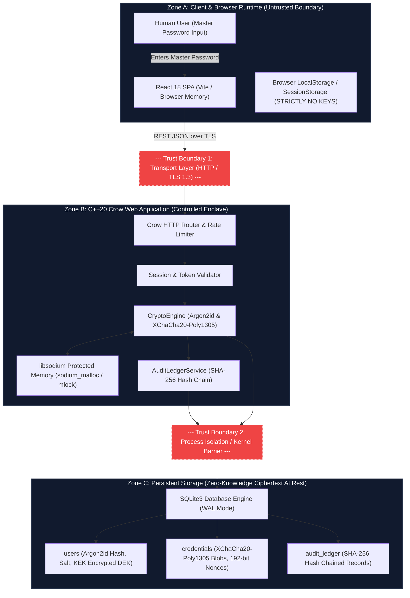
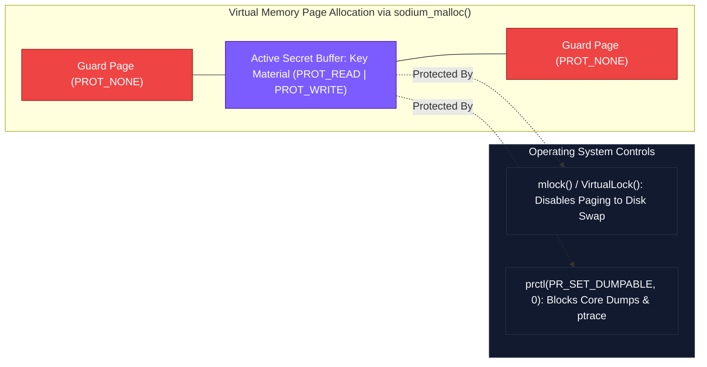

# BlockVault – Comprehensive Threat Model & Security Architecture

> **Document Classification:** Engineering Security Specification  
> **System Name:** BlockVault – Zero-Knowledge Password Management System  
> **Architecture Level:** Defense-in-Depth / Cryptographic Trust Boundaries  
> **Target Standard:** STRIDE Methodology, OWASP ASVS 4.0, NIST SP 800-63B  
> **Companion Documents:** [`ARCHITECTURE.md`](file:///c:/Users/DINESHBABU/password%20man/cpp%20project/BlockVault/ARCHITECTURE.md), [`API_SPEC.md`](file:///c:/Users/DINESHBABU/password%20man/cpp%20project/BlockVault/API_SPEC.md), [`ROADMAP.md`](file:///c:/Users/DINESHBABU/password%20man/cpp%20project/BlockVault/ROADMAP.md)

---

## Table of Contents
1. [Security Objectives & Core Philosophy](#1-security-objectives--core-philosophy)
2. [Trust Boundaries & Zone Architecture](#2-trust-boundaries--zone-architecture)
3. [Attacker Profiles & Threat Actors](#3-attacker-profiles--threat-actors)
4. [STRIDE Threat Analysis](#4-stride-threat-analysis)
   - [4.1 Spoofing (Identity Falsification)](#41-spoofing-identity-falsification)
   - [4.2 Tampering (Data & Ciphertext Alteration)](#42-tampering-data--ciphertext-alteration)
   - [4.3 Repudiation (Disavowing Actions)](#43-repudiation-disavowing-actions)
   - [4.4 Information Disclosure (Data Leakage & Side Channels)](#44-information-disclosure-data-leakage--side-channels)
   - [4.5 Denial of Service (Resource Exhaustion)](#45-denial-of-service-resource-exhaustion)
   - [4.6 Elevation of Privilege (Access Control Bypass)](#46-elevation-of-privilege-access-control-bypass)
5. [Local Hash-Linked Audit Chain vs. Decentralized Blockchain](#5-local-hash-linked-audit-chain-vs-decentralized-blockchain)
6. [Cryptographic Mitigations Matrix (libsodium)](#6-cryptographic-mitigations-matrix-libsodium)
7. [Memory Security & Enclave Protections](#7-memory-security--enclave-protections)
8. [Mentoring Deep Dives for Software Engineering Students](#8-mentoring-deep-dives-for-software-engineering-students)
   - [Deep Dive 1: The STRIDE Threat Modeling Framework](#deep-dive-1-the-stride-threat-modeling-framework)
   - [Deep Dive 2: Zero-Knowledge Architecture & The Master Key Boundary](#deep-dive-2-zero-knowledge-architecture--the-master-key-boundary)
   - [Deep Dive 3: Memory Hardness — Why Argon2id Beats PBKDF2 and Scrypt](#deep-dive-3-memory-hardness--why-argon2id-beats-pbkdf2-and-scrypt)
   - [Deep Dive 4: Authenticated Encryption with Associated Data (AEAD) vs. AES-CBC](#deep-dive-4-authenticated-encryption-with-associated-data-aead-vs-aes-cbc)
   - [Deep Dive 5: Timing Side-Channel Attacks & Constant-Time Operations](#deep-dive-5-timing-side-channel-attacks--constant-time-operations)
   - [Deep Dive 6: Memory Scavenging, Swapping, and Guard Pages (`sodium_malloc`)](#deep-dive-6-memory-scavenging-swapping-and-guard-pages-sodium_malloc)

---

## 1. Security Objectives & Core Philosophy

BlockVault is engineered under the assumption of **Zero-Trust** and **Assume Breach**:
1. **Zero Plaintext at Rest:** Neither the Master Password, Key Encryption Key (KEK), Data Encryption Key (DEK), nor plaintext credential secrets ever touch persistent non-volatile storage (SQLite database, file logs, swap).
2. **Ephemeral In-Memory Secret Lifetime:** Cryptographic keys reside in RAM only while an unlocked session is actively processing a cryptographic operation. Once completed, buffers are purged with `sodium_memzero()`.
3. **Cryptographic Authenticity Over Plain Confidentiality:** Confidentiality without authentication is vulnerable to active bit-flipping attacks. Every ciphertext in BlockVault is authenticated with Poly1305 MACs (XChaCha20-Poly1305).
4. **Append-Only Tamper-Evident Accountability:** Every security-sensitive transaction is irreversibly recorded in a SHA-256 hash-chained local ledger. Any post-facto tampering with historical records renders the cryptographic chain invalid.

```
+---------------------------------------------------------------------------------------+
|                                    BLOCKVAULT TRUST MODEL                             |
+---------------------------------------------------------------------------------------+
|  Untrusted World         |  Transport Zone        |  Application Host  |  Storage     |
|                          |                        |  (In-Memory)       |  (At Rest)   |
|  [Attacker / OS Sniffer] |  [TLS 1.3 / Localhost] |  [Protected RAM]   |  [SQLite3]   |
|                          |                        |                    |              |
|  * Network eavesdropping |  * Encrypted payloads  |  * Guard pages     |  * Encrypted |
|  * Memory scraping       |  * Ephemeral tokens    |  * No core dumps   |    blobs     |
|  * Physical disk theft   |  * Strict headers      |  * sodium_memzero  |  * Hash chain|
+---------------------------------------------------------------------------------------+
```

---

## 2. Trust Boundaries & Zone Architecture

A **Trust Boundary** is a perimeter separating components with different privilege levels or security requirements. Data crossing a trust boundary must be sanitized, validated, and authenticated.



### Trust Zone Descriptions

| Zone | Component | Privileges & Assumptions | Exposure Risks |
| :--- | :--- | :--- | :--- |
| **Zone A** | React Frontend & Client | Untrusted environment. Susceptible to browser extensions, XSS, DOM inspection, shoulder surfing. | Plaintext master password exists in ephemeral memory during typing; token storage. |
| **Boundary 1** | REST API Interface | Transport boundary. Untrusted transmission medium. | Man-in-the-Middle (MitM) packet sniffing, payload injection, replay attacks. |
| **Zone B** | C++20 Crow Service | Semi-trusted application container. Host OS kernel may be subject to debugging or memory dumping. | Memory scraping, core dumps, side-channel timing attacks, heap fragmentation. |
| **Boundary 2** | SQLite IPC / VFS | File system boundary. Data passes from volatile RAM to non-volatile disk blocks. | OS paging/swap write-out, file system indexing, unencrypted temp files. |
| **Zone C** | SQLite Database (`vault.db`) | Completely untrusted at-rest storage. Assumed stolen in physical theft or backup leak. | Direct SQL inspection, offline dictionary brute force, record tampering. |

---

## 3. Attacker Profiles & Threat Actors

| Attacker Profile | Access Level | Primary Objective | Capabilities & Tools |
| :--- | :--- | :--- | :--- |
| **1. The Database Snapshot Stealer** | Cold file access (`vault.db` snapshot) | Extract user credentials, decrypt sensitive passwords, forge historical logs. | SQLite browser, GPU/ASIC hash cracking clusters (hashcat), binary hex editors. |
| **2. The Cold Boot / RAM Dumper** | Local root/admin access to host machine | Scrape encryption keys (KEK/DEK) and plaintext passwords from process memory. | `gcore`, `/proc/kcore`, Volatility framework, physical RAM freeze / DMA attack (PCIe bus). |
| **3. The Network Eavesdropper / MitM** | Intercepts LAN/WAN packets | Capture credentials in transit, hijack sessions, inject malicious payloads. | Wireshark, Burp Suite, ARP spoofing, rogue TLS certificates, proxy injection. |
| **4. The Malicious Local Process** | Low-privilege local user on same OS | Read IPC sockets, inspect `/tmp` files, trigger CPU cache side channels. | Flush+Reload, Prime+Probe, `/proc/$PID/mem` scraping, clipboard monitoring. |
| **5. The Malicious Insider / Operator** | Application operator or disgruntled developer | Tamper with audit logs to conceal unauthorized credential modifications. | Direct database row deletion, timestamp spoofing, log deletion. |

---

## 4. STRIDE Threat Analysis

```
+---------------------------------------------------------------------------------------------------+
|                                  STRIDE THREAT METHODOLOGY MATRIX                                 |
+---+--------------------+-------------------------------------------+------------------------------+
| S | Spoofing           | Impersonating a user or system entity     | Authentication & Signatures  |
| T | Tampering          | Modifying code, data, or ciphertexts      | Authenticated Encryption/MAC |
| R | Repudiation        | Denying an action took place              | Non-repudiation Hash Chain   |
| I | Info Disclosure    | Exposing sensitive data to unauthorized   | Envelope Cryptography & Zero |
| D | Denial of Service  | Depleting memory, CPU, or connections     | Rate Limiting & Cost Caps    |
| E | Elev of Privilege  | Gaining unauthorized admin/vault access   | Strict RBAC & Session Bounds |
+---+--------------------+-------------------------------------------+------------------------------+
```

---

### 4.1 Spoofing (Identity Falsification)

#### Threat S1: Brute-Force & Credential Stuffing of Master Password
* **Attack Mechanism:** An attacker uses automated dictionaries or leaked credential dumps against `POST /api/v1/auth/login`.
* **Impact:** Compromise of master password allows decryption of the entire user vault.
* **Mitigation:**
  1. **Argon2id Memory Hardness:** Derivation cost is tuned to 64 MiB RAM and 3 iterations, restricting GPU parallelization to fewer than 5 guesses per second per GPU core.
  2. **Rate Limiting:** Crow middleware enforces maximum 5 login attempts per IP per 5-minute sliding window. Exceeded thresholds trigger exponential backoff.
  3. **Account Lockout / Delay:** Progressive delay delays response time for consecutive failures.

#### Threat S2: Session Hijacking via Stolen Bearer Token
* **Attack Mechanism:** Cross-site scripting (XSS) or network interception captures active session tokens.
* **Impact:** Attacker issues valid API requests impersonating the authenticated user.
* **Mitigation:**
  1. Cryptographically random 256-bit session tokens generated via `randombytes_buf()`.
  2. Session bound to user agent and IP subnet hash.
  3. Strict 15-minute inactivity timeout with immediate revocation on logout.
  4. Cookies marked `HttpOnly; Secure; SameSite=Strict`.

---

### 4.2 Tampering (Data & Ciphertext Alteration)

#### Threat T1: Ciphertext Bit-Flipping in SQLite Database
* **Attack Mechanism:** Attacker with database access modifies bits inside the `encrypted_payload` blob in the `credentials` table.
* **Impact:** In unauthenticated ciphermodes (like AES-CBC), controlled bit flipping alters decrypted plaintext without detection.
* **Mitigation:**
  1. **AEAD via XChaCha20-Poly1305:** Every encrypted blob includes a 128-bit Poly1305 Message Authentication Code (MAC).
  2. Any single-bit alteration in ciphertext or associated data causes `crypto_aead_xchacha20poly1305_ietf_decrypt()` to fail immediately with a verification error, returning zero bytes and raising a security alarm.

#### Threat T2: Audit Log Alteration or Row Deletion
* **Attack Mechanism:** A malicious database operator modifies historical event logs or deletes rows to conceal unauthorized access.
* **Impact:** Loss of forensic integrity and accountability.
* **Mitigation:**
  1. **Append-Only SHA-256 Hash Chain:** Every audit record incorporates the cryptographic hash of its predecessor:
     $$\text{Hash}_n = \text{SHA256}(\text{Index}_n \parallel \text{Timestamp}_n \parallel \text{EventType}_n \parallel \text{UserID}_n \parallel \text{PrevHash}_{n-1})$$
  2. Altering, reordering, or deleting any historical record breaks the chain, causing `GET /api/v1/audit/verify` to pinpoint the exact tampering index.

---

### 4.3 Repudiation (Disavowing Actions)

#### Threat R1: Denying Credential Modifications or Vault Export
* **Attack Mechanism:** A compromised user account deletes a mission-critical credential and claims the system malfunctioned or a bug occurred.
* **Impact:** Dispute over system reliability and inability to determine whether user intent or system error caused data loss.
* **Mitigation:**
  1. The audit ledger records every creation, modification, deletion, export, and unlock attempt synchronously within the same SQLite transaction.
  2. Audit records are stamped with high-resolution ISO-8601 UTC timestamps, IP hash, and immutable sequence indices.
  3. The audit ledger is append-only: the application database user lacks `UPDATE` or `DELETE` permissions on `audit_ledger`.

---

### 4.4 Information Disclosure (Data Leakage & Side Channels)

#### Threat I1: Memory Scraping via Core Dumps or Swap Paging
* **Attack Mechanism:** Operating system writes inactive RAM pages containing KEK/DEK to swapfile (`pagefile.sys`), or a crash dump generates a core file containing plaintext secrets.
* **Impact:** Secrets recovered from disk by analyzing crash dumps or carving swap partitions.
* **Mitigation:**
  1. **Memory Locking:** Sensitive key containers use `sodium_mlock()` (invoking `VirtualLock` on Windows / `mlock` on POSIX) to prevent operating system paging to disk.
  2. **Core Dump Disabling:** Linux builds invoke `prctl(PR_SET_DUMPABLE, 0)` to prohibit core dumps.
  3. **Guard Pages:** `sodium_malloc()` surrounds sensitive buffers with read/write protected guard pages that instantly trigger a hardware segfault if out-of-bounds access occurs.
  4. **Guaranteed Zeroization:** `sodium_memzero()` cleanses memory buffers in RAII destructors, immune to compiler dead-code elimination.

#### Threat I2: Timing Side-Channel in Hash Comparison
* **Attack Mechanism:** Attacker measures sub-microsecond variations when comparing password hashes or MACs using standard `memcmp()` or `std::string::operator==`.
* **Impact:** Byte-by-byte recovery of authentication tokens or cryptographic hashes.
* **Mitigation:**
  1. Strict utilization of constant-time comparison primitives: `sodium_memcmp()` and `crypto_verify_32()`. Execution time is invariant to where the first byte mismatch occurs.

#### Threat I3: Exposure of Sensitive Information in Error Logs or API Payloads
* **Attack Mechanism:** System unhandled exceptions or error messages leak SQL queries, stack traces, or internal variable states to the client.
* **Impact:** Attacker gains intelligence regarding database schema, libraries, or memory addresses (ASLR defeat).
* **Mitigation:**
  1. Centralized C++ exception handler catches all exceptions and outputs normalized generic JSON error envelopes (`{ "error": "Internal server error", "code": "ERR_INTERNAL" }`).
  2. Detailed error logs are restricted to internal debugging log channels and never transmit secrets or stack traces over the network.

---

### 4.5 Denial of Service (Resource Exhaustion)

#### Threat D1: Memory Exhaustion via Malicious Argon2id Cost Requests
* **Attack Mechanism:** Attacker sends repeated parallel login requests designed to force the server to allocate massive amounts of RAM for Argon2id key derivation.
* **Impact:** Server out-of-memory (OOM) killer terminates the C++ daemon.
* **Mitigation:**
  1. Hardcoded server-side Argon2id cost bounds: operations are queued via an internal thread pool with maximum concurrent derivations set to $\min(\text{Hardware Threads}, 4)$.
  2. Incoming unauthenticated requests beyond the queue threshold are rejected with `HTTP 429 Too Many Requests`.

#### Threat D2: Database Lock Contention (SQLite Single-Writer Lock)
* **Attack Mechanism:** Attacker initiates multiple long-running transactions that monopolize the SQLite write lock.
* **Impact:** Legitimate users experience timeouts and read/write failures.
* **Mitigation:**
  1. SQLite configured in **Write-Ahead Logging (WAL)** mode (`PRAGMA journal_mode=WAL`), allowing concurrent readers while a single writer executes.
  2. C++ `DatabaseConnection` enforces a busy timeout of 5000ms (`PRAGMA busy_timeout=5000`) and keeps write transactions strictly sub-millisecond.

---

### 4.6 Elevation of Privilege (Access Control Bypass)

#### Threat E1: Insecure Direct Object Reference (IDOR) on Vault Records
* **Attack Mechanism:** Authenticated User A passes the `credential_id` belonging to User B to `GET /api/v1/vault/{id}`.
* **Impact:** User A views or modifies User B's encrypted credentials.
* **Mitigation:**
  1. Every database query includes a mandatory tenant isolation predicate:  
     `WHERE id = ? AND user_id = ?`
  2. User ID is extracted exclusively from the cryptographically verified session token, never from user-supplied URL or JSON parameters.
  3. Even in the event of an IDOR logical flaw, User A lacks User B's Data Encryption Key (DEK) and cannot decrypt the payload.

#### Threat E2: SQL Injection (SQLi)
* **Attack Mechanism:** Attacker embeds SQL control sequences (`' OR 1=1 --`) in website names, usernames, or search filters.
* **Impact:** Database exfiltration, arbitrary record modification, or database schema destruction.
* **Mitigation:**
  1. Zero raw SQL string concatenation throughout the entire C++ codebase.
  2. All queries executed through the `PreparedStatement` RAII wrapper with typed parameter binding (`sqlite3_bind_text`, `sqlite3_bind_blob`, `sqlite3_bind_int64`).

---

## 5. Local Hash-Linked Audit Chain vs. Decentralized Blockchain

A critical architectural and technical mentoring principle of BlockVault is **intellectual honesty**: BlockVault utilizes a **hash-linked ledger**, inspired by blockchain data structures, but **is NOT a decentralized blockchain**.

```
+--------------------------------------------------------------------------------------------------+
|                  ARCHITECTURAL COMPARISON: LOCAL HASH CHAIN VS. BLOCKCHAIN                       |
+--------------------------+------------------------------------+----------------------------------+
| Dimension                | BlockVault Audit Ledger            | Public Blockchain (e.g. Bitcoin) |
+--------------------------+------------------------------------+----------------------------------+
| Distributed Consensus    | None (Single-host authority)       | Proof-of-Work (PoW) / PoS        |
| Peer-to-Peer Network     | No (Local SQLite embedded engine)  | Thousands of distributed nodes   |
| Sybil Resistance         | OS Access Controls & Linux DAC     | Mining difficulty / Stake bond   |
| Latency & Throughput     | Sub-millisecond (< 0.1ms per write)| Seconds to minutes per block     |
| Cryptographic Primitive  | SHA-256 Hash Chaining              | Merkle-Trees + ECDSA Signatures  |
| Primary Purpose          | Tamper-evidence & Forensic Trace   | Trustless Double-Spend Prevention|
| Energy / Computation Cost| Negligible CPU cycles              | Significant global electricity   |
+--------------------------+------------------------------------+----------------------------------+
```

### Why a Local Hash Chain is the Right Architecture for a Password Manager
1. **Confidentiality Requirements:** Storing credential transactions on a decentralized, publicly broadcast blockchain violates privacy. Even encrypted hashes can leak metadata (timing, frequency, size) across public ledgers.
2. **Speed & Latency:** Password managers require instantaneous local reads and writes. Waiting for distributed consensus blocks (seconds or minutes) is completely unusable for interactive desktop applications.
3. **Auditability without Overhead:** A cryptographic hash chain provides full mathematical proof of whether any record has been modified, appended out of order, or deleted, providing complete enterprise compliance (SOC 2, ISO 27001) with zero distributed consensus overhead.

---

## 6. Cryptographic Mitigations Matrix (libsodium)

```
+---------------------------------------------------------------------------------------------------+
|                                  LIBSODIUM CRYPTOGRAPHIC IMPLEMENTATION                           |
+--------------------------+-------------------------------------------+----------------------------+
| Security Function        | libsodium Function Call                   | Cryptographic Parameters   |
+--------------------------+-------------------------------------------+----------------------------+
| Master Key Derivation    | crypto_pwhash_argon2id()                  | OPSLIMIT_MODERATE (3),     |
|                          |                                           | MEMLIMIT_MODERATE (64 MiB) |
| Authenticated Encryption | crypto_aead_xchacha20poly1305_ietf_enc()  | 256-bit Key, 192-bit Nonce,|
|                          |                                           | 128-bit Poly1305 Auth Tag  |
| Authenticated Decryption | crypto_aead_xchacha20poly1305_ietf_dec()  | Tag verification + Decrypt |
| CSPRNG Random Generation | randombytes_buf()                         | OS CryptGenRandom/getrandom|
| Hash-Linked Audit Chain  | crypto_hash_sha256()                      | 256-bit output hash        |
| Constant-Time Comparison | sodium_memcmp() / crypto_verify_32()      | Invariant execution time   |
| Memory Protection        | sodium_malloc() / sodium_mprotect_*()     | Guard pages + locked RAM   |
| Memory Cleansing         | sodium_memzero()                          | Immune to compiler dead    |
|                          |                                           | code optimization          |
+--------------------------+-------------------------------------------+----------------------------+
```

---

## 7. Memory Security & Enclave Protections

BlockVault implements a multi-layer defense against RAM-based attacks:



### RAII-Driven Memory Lifecycle (`SecureBuffer`)
```cpp
// Conceptual C++20 Enclave Architecture
class SecureBuffer {
private:
    void*  m_ptr{nullptr};
    size_t m_size{0};

public:
    explicit SecureBuffer(size_t size) : m_size(size) {
        // 1. Allocate with libsodium guard pages
        m_ptr = sodium_malloc(m_size);
        if (!m_ptr) throw std::bad_alloc();

        // 2. Lock memory page to prevent OS swap-to-disk
        sodium_mlock(m_ptr, m_size);
    }

    ~SecureBuffer() {
        if (m_ptr) {
            // 3. Cryptographically zero the buffer before free
            sodium_memzero(m_ptr, m_size);
            sodium_munlock(m_ptr, m_size);
            sodium_free(m_ptr);
            m_ptr = nullptr;
        }
    }

    // Prohibit copying to prevent unintended secret duplication in RAM
    SecureBuffer(const SecureBuffer&) = delete;
    SecureBuffer& operator=(const SecureBuffer&) = delete;

    // Enable move semantics for explicit ownership transfer
    SecureBuffer(SecureBuffer&& other) noexcept 
        : m_ptr(other.m_ptr), m_size(other.m_size) {
        other.m_ptr = nullptr;
        other.m_size = 0;
    }
};
```

---

## 8. Mentoring Deep Dives for Software Engineering Students

---

### Deep Dive 1: The STRIDE Threat Modeling Framework

#### 1. What it is
STRIDE is a threat modeling methodology invented at Microsoft in 1999. It serves as a mnemonic checklist for systematically categorizing software vulnerabilities: **S**poofing, **T**ampering, **R**epudiation, **I**nformation Disclosure, **D**enial of Service, and **E**levation of Privilege.

#### 2. Why it is required
Junior engineers frequently design software by focusing exclusively on "happy paths" (functional requirements). Without structured threat modeling, security is treated as an afterthought—developers patch bugs reactively after breaches occur. STRIDE forces engineers to view every trust boundary through the eyes of an attacker *before* writing code.

#### 3. How it works
For every interface, component, and data flow in your architecture:
1. Decompose the system into data flow diagrams (DFDs).
2. Trace every boundary where data transitions between privilege zones.
3. Systematically test the boundary against all six STRIDE categories.
4. Define concrete technical mitigations for every identified threat.

#### 4. Alternatives
- **PASTA (Process for Attack Simulation and Threat Analysis):** Risk-centric, business-oriented framework.
- **DREAD:** Quantitative ranking system (Damage, Reproducibility, Exploitability, Affected Users, Discoverability).
- **VA/PT:** Purely reactive vulnerability scanning.

#### 5. Advantages and Disadvantages
* **Advantages:** Simple to learn, provides comprehensive coverage of software threats, aligns directly with security primitives (Authentication, Integrity, Non-repudiation, Confidentiality, Availability, Authorization).
* **Disadvantages:** Can be repetitive on large distributed systems; does not model complex socio-technical or organizational human factors.

---

### Deep Dive 2: Zero-Knowledge Architecture & The Master Key Boundary

#### 1. What it is
A **Zero-Knowledge Architecture** is a design pattern where the service host operates on encrypted data without possessing the cryptographic keys required for decryption. The host has zero knowledge of the plaintext.

#### 2. Why it is required
In standard cloud systems, databases store plaintexts or use server-managed encryption keys. If the server infrastructure is compromised, subpoenaed, or breached by a rogue operator, all customer data is compromised. Zero-Knowledge guarantees that even with total server physical compromise, the stolen data is indistinguishable from random noise.

#### 3. How it works
1. The user creates a **Master Password**.
2. Client/Server derives a **Key Encryption Key (KEK)** using a memory-hard KDF (Argon2id) and a unique per-user salt.
3. The KEK is used exclusively in RAM to decrypt an encrypted **Data Encryption Key (DEK)**.
4. The DEK encrypts and decrypts the individual credential records.
5. Neither the Master Password nor the unencrypted DEK is ever written to disk or transmitted across unsecured networks.

#### 4. Alternatives
- **Server-Side Encryption with KMS (AWS KMS / HashiCorp Vault):** The server holds or accesses the key; host compromises leak all secrets.
- **Client-Side Hashing (Blind Storage):** Hashing passwords client-side without envelope encryption prevents search, partial updates, and recovery.

#### 5. Advantages and Disadvantages
* **Advantages:** Absolute cryptographic privacy; immune to server-side database theft; zero liability for compromised service operators.
* **Disadvantages:** No "Forgot Password" backdoor. If the user forgets their Master Password and loses their 24-word recovery seed, their data is mathematically irrecoverable.

---

### Deep Dive 3: Memory Hardness — Why Argon2id Beats PBKDF2 and Scrypt

#### 1. What it is
A **Key Derivation Function (KDF)** transforms an arbitrary human password into a fixed-length cryptographic key. **Memory-hard KDFs** require substantial physical RAM to compute each hash iteration, rather than just CPU cycles.

#### 2. Why it is required
Attackers crack leaked passwords using specialized parallel hardware: **GPUs** (with thousands of lightweight cores) and **ASICs** (custom silicon chips). Standard hash algorithms like SHA-256 or MD5 require tiny silicon area, allowing an attacker to test billions of passwords per second. PBKDF2 requires only CPU iterations with negligible RAM, making it trivially cracked on modern GPUs.

#### 3. How it works
Argon2id fills a large memory buffer (e.g., 64 MiB) with pseudo-random data and repeatedly accesses and overwrites memory locations in a data-dependent and time-dependent pattern. 
- Because GPUs have limited fast on-chip cache per core, forcing 64 MiB per derivation causes severe memory thrashing and bottlenecks on memory bandwidth.
- **Argon2d** accesses memory based on password values (fast, but susceptible to side-channel cache attacks).
- **Argon2i** accesses memory independently of password values (resistant to side-channel attacks, but vulnerable to tradeoff attacks).
- **Argon2id** combines both: it executes the first pass like Argon2i for side-channel defense, and subsequent passes like Argon2d for maximum ASIC/GPU resistance.

#### 4. Alternatives
- **PBKDF2 (NIST SP 800-132):** Antiquated. Zero memory hardness. Highly vulnerable to GPU acceleration.
- **bcrypt:** Memory-hard up to 4 KB, but cannot scale its memory cost higher.
- **scrypt:** Strong memory hardness, but vulnerable to side-channel cache timing attacks.

#### 5. Advantages and Disadvantages
* **Advantages:** Winner of the Password Hashing Competition (PHC); configurable time, memory, and parallelism parameters; hybrid resilience against both side-channel and GPU attacks.
* **Disadvantages:** Slightly higher CPU latency on constrained IoT embedded chips (not an issue on modern desktop/server hardware).

---

### Deep Dive 4: Authenticated Encryption with Associated Data (AEAD) vs. AES-CBC

#### 1. What it is
**AEAD** is a class of symmetric cryptographic ciphers that simultaneously provides three guarantees:
1. **Confidentiality:** Eavesdroppers cannot read the ciphertext.
2. **Integrity:** Attackers cannot alter the ciphertext without detection.
3. **Authenticity:** Verifies that the ciphertext originated from an entity holding the shared key.

#### 2. Why it is required
Historically, systems combined separate algorithms (e.g., AES-CBC for encryption + HMAC-SHA256 for authentication). If implemented incorrectly (e.g., MAC-then-Encrypt instead of Encrypt-then-MAC), devastating vulnerabilities occur, such as **Padding Oracle Attacks** (e.g., the POODLE and Lucky Thirteen attacks), which allow attackers to recover plaintext byte by byte.

#### 3. How it works
BlockVault uses **XChaCha20-Poly1305**:
- **XChaCha20:** A stream cipher based on a 256-bit key and an extended **192-bit nonce**. The 192-bit nonce is large enough that random generation (`randombytes_buf`) guarantees the probability of nonce reuse is virtually zero ($2^{-96}$).
- **Poly1305:** A high-speed, one-time universal authenticator that calculates a 128-bit MAC over the ciphertext and optional unencrypted **Associated Data** (e.g., record IDs or version metadata).
- During decryption, the Poly1305 tag is checked *first*. If even a single bit of the ciphertext has been modified, the algorithm rejects the payload without running decryption routines.

#### 4. Alternatives
- **AES-256-GCM:** Hardware-accelerated on modern CPUs (via AES-NI), but uses a 96-bit nonce. Random 96-bit nonces suffer from birthday-paradox collisions after approximately $2^{32}$ encryptions under the same key.
- **AES-256-CBC:** Lacks authentication. Vulnerable to padding oracles without a strictly validated external HMAC.

#### 5. Advantages and Disadvantages
* **Advantages:** Extended 192-bit nonce completely eliminates nonce reuse risk; constant-time implementation in pure software without requiring dedicated CPU hardware instructions (AES-NI).
* **Disadvantages:** Slightly slower than hardware-accelerated AES-GCM on chips with dedicated AES silicon (negligible difference for password payloads).

---

### Deep Dive 5: Timing Side-Channel Attacks & Constant-Time Operations

#### 1. What it is
A **Timing Side-Channel Attack** occurs when an attacker measures subtle variations in the execution time of an algorithm to extract secret information (keys, passwords, tokens).

#### 2. Why it is required
Standard programming language string comparison functions (`==`, `memcmp`, `strcmp`) are optimized for performance using **early exit**:
```cpp
// VULNERABLE TO TIMING ATTACKS:
bool insecure_compare(const char* a, const char* b, size_t len) {
    for (size_t i = 0; i < len; ++i) {
        if (a[i] != b[i]) return false; // Early return!
    }
    return true;
}
```
If the first character differs, the function returns in 1 CPU cycle. If the first 10 characters match, it returns in 10 CPU cycles. An attacker measuring round-trip network response times with statistical averaging (e.g., box-plot analysis) can deduce the correct character byte-by-byte.

#### 3. How it works
Constant-time comparison algorithms inspect every single byte of both buffers, regardless of mismatches:
```cpp
// CONSTANT-TIME COMPARISON (libsodium sodium_memcmp):
int constant_time_compare(const unsigned char* a, const unsigned char* b, size_t len) {
    unsigned char result = 0;
    for (size_t i = 0; i < len; ++i) {
        result |= (a[i] ^ b[i]); // Bitwise OR accumulates differences
    }
    return result; // 0 if and only if all bytes matched
}
```
Execution time is identical whether zero bytes match or all bytes match.

#### 4. Alternatives
- Blind token hashing: comparing SHA-256 hashes of tokens instead of plain tokens (mitigates timing leak against raw tokens, but hash comparison itself must still be constant-time).

#### 5. Advantages and Disadvantages
* **Advantages:** Completely neutralizes timing leakage; mathematically proven side-channel immunity.
* **Disadvantages:** Performs slightly more work for mismatched buffers (completely irrelevant for security-critical comparisons under 1 KB).

---

### Deep Dive 6: Memory Scavenging, Swapping, and Guard Pages (`sodium_malloc`)

#### 1. What it is
Memory security techniques designed to protect volatile application state from inspection by unauthorized processes, kernel core dumps, and swap file persistence.

#### 2. Why it is required
When an operating system runs low on physical RAM, the virtual memory manager transfers pages of RAM to non-volatile disk storage (Windows `pagefile.sys` or Linux swap partition). If an application stores an encryption key in standard heap memory (`malloc` or `new`), that key may be written to disk in plaintext and persist for months after the machine powers down. Furthermore, memory safety bugs (buffer overruns) can allow attackers to read adjacent memory chunks (e.g., Heartbleed).

#### 3. How it works
1. **`sodium_malloc()`:** Allocates the requested buffer on page boundaries and positions memory pages with `PROT_NONE` permissions immediately before and after the allocated block. Any pointer read or write that exceeds the buffer boundary immediately triggers a hardware page fault and halts the process.
2. **`sodium_mlock()`:** Issues kernel system calls (`VirtualLock` on Windows, `mlock` on POSIX) instructing the virtual memory manager never to page this memory block to swap.
3. **`sodium_memzero()`:** Compilers often optimize away standard `memset(buf, 0, size)` calls if the variable is not read again before leaving scope (dead code elimination). `sodium_memzero()` uses volatile pointer semantics and compiler memory barriers to guarantee memory is physically wiped.

#### 4. Alternatives
- Standard `std::vector<uint8_t>`: Vulnerable to heap fragmentation, compiler dead-code elimination, and swap file persistence.
- Hardware Enclaves (Intel SGX / ARM TrustZone): Exceptional security, but introduces proprietary hardware dependencies and significant development complexity.

#### 5. Advantages and Disadvantages
* **Advantages:** Defense-in-depth against RAM dumps, cold boot attacks, and buffer overruns; platform-independent via libsodium.
* **Disadvantages:** Uses slightly more virtual memory address space due to page alignment and guard pages (insignificant for cryptographic key storage).

---
*End of Specification — BlockVault Systems Architecture Engineering Team.*
